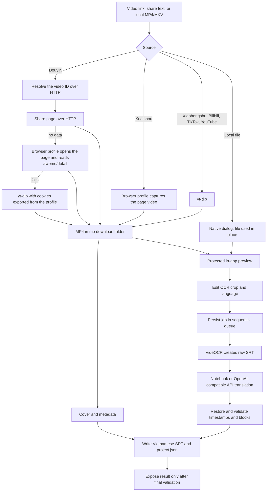
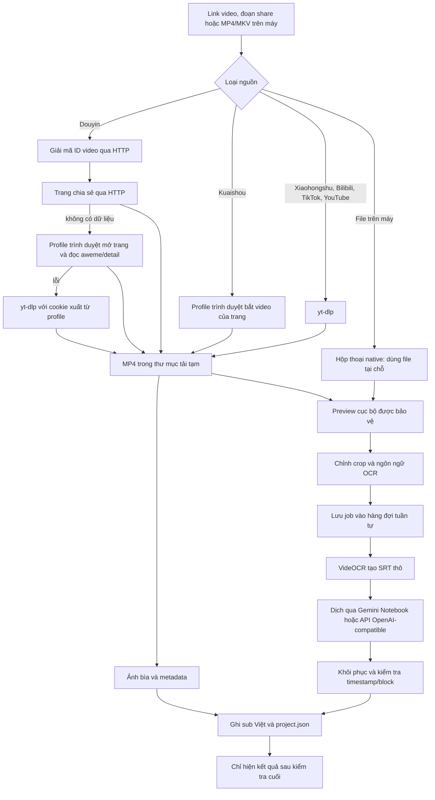

<p align="center">
  
</p>

<h1 align="center">VietSub Studio</h1>

<p align="center">
  An open-source Windows desktop workflow that turns Douyin, Kuaishou, Xiaohongshu, Bilibili, TikTok, or YouTube videos and local MP4/MKV files into timestamp-safe Vietnamese subtitle projects: preview the exact OCR region, queue multiple videos, extract text with VideOCR, translate through Gemini Notebook or a configured API, validate the SRT, and keep every intermediate result recoverable.<br>
  Công cụ desktop Windows mã nguồn mở biến video Douyin, Kuaishou, Xiaohongshu, Bilibili, TikTok, YouTube hoặc file MP4/MKV trên máy thành dự án phụ đề Việt giữ nguyên timestamp: xem/chỉnh chính xác vùng OCR, xếp nhiều video vào hàng đợi, nhận chữ bằng VideOCR, dịch qua Gemini Notebook hoặc API đã cấu hình, kiểm tra SRT và giữ lại file trung gian để có thể chạy tiếp khi gặp lỗi.
</p>

<p align="center">
  <a href="https://github.com/qvinh8726/VietSub-Studio/releases/latest">Download / Tải bản mới nhất</a>
  · <a href="#english">English</a>
  · <a href="#tiếng-việt">Tiếng Việt</a>
  · <a href="CONTRIBUTING.md">Contributing / Đóng góp</a>
</p>

<p align="center">
  
  
  
  
</p>

> [!IMPORTANT]
> The portable EXE contains VietSub Studio and its video downloader (yt-dlp), but it does **not** bundle VideOCR, Google Chrome (or Microsoft Edge), a Google account, a Gemini Notebook, an external API account, or the JavaScript runtime YouTube needs. Those are external prerequisites depending on the selected source and translation provider. Since v1.6.0, Douzy is no longer needed.
>
> File EXE portable chứa VietSub Studio và bộ tải video (yt-dlp) nhưng **không** đóng gói VideOCR, Google Chrome (hoặc Microsoft Edge), tài khoản Google, Gemini Notebook, tài khoản API ngoài hoặc JavaScript runtime mà YouTube cần. Thành phần cần có tuỳ nguồn video và provider dịch đã chọn. Từ v1.6.0, app không cần Douzy nữa.
>
> Downloaded videos wait in `.vietsub-downloads` inside the output folder, then move into their project folder after the Vietnamese SRT passes validation, so one full-size copy exists and every completed project is self-contained. In the desktop window, a local MP4/MKV is used where it is and hard-linked into the project on the same drive (copied otherwise); nothing is uploaded or copied to `%TEMP%`.
>
> Video tải về nằm chờ trong `.vietsub-downloads` bên trong thư mục xuất, rồi được chuyển vào folder project sau khi SRT tiếng Việt vượt qua kiểm tra; nhờ vậy chỉ có một bản video dung lượng lớn và mỗi project hoàn tất đều tự chứa đủ file. Trong cửa sổ app, file MP4/MKV trên máy được dùng tại chỗ và hard-link vào project nếu cùng ổ đĩa (khác ổ thì sao chép); không upload, không sao chép qua `%TEMP%`.

---

# English

## Table of contents

- [What is VietSub Studio?](#what-is-vietsub-studio)
- [Why this project exists](#why-this-project-exists)
- [Features](#features)
- [What the output looks like](#what-the-output-looks-like)
- [Requirements](#requirements)
- [Quick start with the portable EXE](#quick-start-with-the-portable-exe)
- [First-run setup](#first-run-setup)
- [Processing videos](#processing-videos)
- [Running from source](#running-from-source)
- [Command-line usage](#command-line-usage)
- [Building the Windows app](#building-the-windows-app)
- [How it works](#how-it-works)
- [Configuration and local data](#configuration-and-local-data)
- [Privacy and security](#privacy-and-security)
- [Known limitations](#known-limitations)
- [Troubleshooting](#troubleshooting)
- [Frequently asked questions](#frequently-asked-questions)
- [Contributing](#contributing)

## What is VietSub Studio?

VietSub Studio is a Windows desktop orchestration tool for creators who need to turn burned-in subtitles inside long videos into editable Vietnamese SRT files. It is not a replacement for VideOCR, Chrome, Gemini, yt-dlp, or a full video editor. Instead, it connects those tools into one repeatable workflow with preview, queueing, retry, validation, local project files, and update management.

The complete workflow is:

1. Accept a video link or a share message pasted from a phone app (Douyin, Kuaishou, Xiaohongshu, Bilibili, TikTok, YouTube), or an MP4/MKV picked on the user's machine.
2. Resolve share links over HTTP while every redirect stays on the platform, reject profile/playlist/collection/livestream URLs, and identify the exact source video.
3. Download the video: Douyin from its public share page over HTTP, then in the app's own browser profile (Google Chrome by default; the page's own `aweme/detail` data and a watermark-free H.264 MP4), then with yt-dlp; Kuaishou through the same browser profile; and Xiaohongshu, Bilibili, TikTok, and YouTube through yt-dlp. A local file is used in place.
4. Stream the prepared video into the in-app preview and let the user drag or resize the OCR rectangle over the exact subtitle region.
5. Save the crop, OCR language, speed options, project name, source metadata, and video resolution as an independent queue job.
6. Run OCR and the selected translator sequentially for one active video. While that video is in OCR or translation, prefetch the next queued download without ever running two downloads together.
7. Keep a downloaded video in the download folder while it is processed, then move it with its metadata and cover into the project folder only after translation succeeds.
8. Ask the installed VideOCR CLI to scan only the selected area and write the original-language `.raw.srt` file.
9. Connect to the selected translator: Playwright for Gemini Notebook or an OpenAI-compatible `/chat/completions` API for DeepSeek/OpenRouter/custom endpoints.
10. Put every translated block back on its source index and timecode when the translator renumbers or retimes it, then reject incomplete translations, missing or glued blocks, invalid timestamps, and output that is still Chinese.
11. Write the Vietnamese `.vi.srt`, the thumbnail when the source has one, and the `project.json` manifest. A job is marked successful only when the video reference and both subtitle files pass validation.

The application runs as a Flask service bound only to `127.0.0.1` and is presented as a native desktop window through pywebview/WebView2. Queue data, settings, downloaded media, OCR output, and browser sessions stay on the user's computer. Subtitle text is sent to the translation provider you select. The other network connections (update checks, video platforms and their CDNs) are listed under [Privacy and security](#privacy-and-security).

## Why this project exists

The project is designed around the parts of long-form subtitle work that become slow, repetitive, or unstable when performed manually:

- A two-hour video can make editing software sluggish long before subtitle translation is complete.
- Burned-in subtitles require a carefully selected OCR region; scanning the entire frame wastes time and increases recognition noise.
- Downloading or copying the same large source video more than once consumes unnecessary disk space. A 6 GB Douyin video should remain one 6 GB file, not become 12 GB before OCR even begins.
- Running multiple OCR or browser-automation jobs in parallel creates resource contention and makes failures harder to diagnose. VietSub Studio accepts multiple jobs but deliberately processes them one at a time.
- Gemini can return partial SRT, alter timestamps, or require a renewed Google session. The app validates the final structure and exposes a visible browser fallback instead of silently reporting success.
- A failed translation should not force another download or OCR pass. Queue persistence and stage-aware retry reuse the prepared video and raw SRT whenever they are still valid.
- Open-source users need a clear installation and update path. The portable build includes an update banner, verified ZIP installation, automatic restart, and a manual GitHub fallback.

## Features

### Video input and source handling

- Accepts Douyin (`douyin.com/video/…`, `?modal_id=` feed links, `v.douyin.com` share links), Kuaishou (`kuaishou.com/short-video/…`, `v.kuaishou.com`), Xiaohongshu (`xiaohongshu.com/explore/…` with its `xsec_token`, `xhslink.com`), Bilibili (`BV…`, `b23.tv`), TikTok, and YouTube links, as well as complete share messages copied from the phone apps.
- Extracts URLs automatically and validates the real hostname to reject lookalike or malicious domains.
- Rejects profile, playlist, collection, mix, and livestream links because every queue item must represent one exact video.
- Downloads Douyin videos in three steps. The public share page `www.iesdouyin.com/share/video/<id>/` is read over HTTP first, without a browser. When it has no data, the app opens the video in its own browser profile (`www.douyin.com/jingxuan?modal_id=<id>`), reads the `aweme/detail` JSON that the page itself requests (the SSR data and the modal's `<video>` element are fallbacks), and streams the watermark-free MP4 with the profile's cookies, User-Agent, and `Referer`. yt-dlp with cookies exported from that profile into a temporary file is the last method. H.264 renditions are preferred over H.265 so VideOCR, FFmpeg, and the preview can decode them.
- Stops at once with instructions when Douyin only shows the video to signed-in users (the page leaves the video or shows its login popup), instead of waiting for a timeout.
- Captures Kuaishou videos the same way from the post page, and downloads Xiaohongshu, Bilibili, TikTok, and YouTube with the bundled yt-dlp (Xiaohongshu falls back to the page in the browser).
- Brings the browser to the front when Douyin shows a captcha or a Kuaishou/Xiaohongshu page needs a login, shows the request in the app, and waits up to 3 minutes for the user.
- Shows live download progress (percent, MB, speed) and stops a download within about a second on **Cancel job**.
- Reuses a finished download and a video still present in an old Douzy library instead of downloading again.
- Moves the downloaded video, its metadata, and its cover into the completed project folder without leaving a second full-size copy.
- Opens a local MP4 or MKV with the native file dialog and uses it in place: no upload, no copy in `%TEMP%`, no copy in the app cache.
- Hard-links the source video into the completed project on the same drive, with a full-copy fallback across drives or unsupported filesystems.

### OCR preview and recognition

- Streams a protected local video preview inside the app before starting OCR.
- Provides a visible, draggable, and resizable crop rectangle for the burned-in subtitle area.
- Stores crop coordinates per queue item and can reuse a saved default crop.
- Supports Chinese, English, Japanese, Korean, and Vietnamese OCR modes.
- Lets users choose the fast mobile OCR model, the accurate server model, or the existing VideOCR configuration, plus an optional frame-skip interval.
- Uses FFprobe when available to convert preview coordinates accurately to the source resolution.
- Scans long videos in 10-minute chunks, merges the raw SRT with original timestamps, and uses FFmpeg to normalize mixed-resolution segments that crash VideOCR.
- Gives each VideOCR run a time limit of three times the scanned length plus 10 minutes, at least 30 minutes, or 4 hours when the length is unknown.
- Calls the locally installed VideOCR CLI and writes raw OCR output to a dedicated `.raw.srt` file.

### Sequential queue and recovery

- Lets users prepare multiple linked and local jobs before processing starts.
- Uses one sequential OCR/translation worker and prefetches at most one future download after the active job leaves its download step.
- Persists queued, running, successful, failed, and cancelled job metadata across app restarts.
- Supports removing waiting jobs, cancelling the active job, and clearing finished jobs.
- Stops VideOCR and FFmpeg together with their child processes, and interrupts a running download, when a job is cancelled or the app closes. The worker does not start another job while the app is closing.
- Retries from the earliest reusable stage: video preparation, OCR, or translation.
- Keeps incomplete project folders accessible without presenting them as successful results.
- Restores progress and incremental logs after a UI reload.

### Translation providers and browser automation

- Supports Gemini Notebook through the automation browser, direct DeepSeek API, OpenRouter, and other OpenAI-compatible chat APIs.
- Uses the user's own Gemini Notebook URL and Google session when Notebook mode is selected.
- Encrypts API keys with Windows DPAPI and saves a separate key for each provider and Base URL host, so switching providers never sends one service's key to another.
- Ships neutral default translation instructions for any kind of video. The **Game Delta Force** preset adds that game's proper-noun glossary and pronoun rules. Instructions you saved in an earlier version are kept.
- Tells the model the job's real OCR language; Vietnamese OCR text is proofread instead of translated.
- Uses Google Chrome by default, or Microsoft Edge or another Chromium `.exe` chosen in Settings, always with the app's own profile (`--user-data-dir` in the config folder), so it runs next to the browser you work in and never uses your profile. Playwright connects to it over CDP on `127.0.0.1:9222` only.
- Starts the browser only when it is needed (Gemini Notebook, a download that needs a page, or a login button), never when the app opens with an API provider. Only one request starts it at a time, and the start tab is reused, so no duplicate tabs open.
- Starts the browser minimized by default while disabling background throttling that could stall automation.
- Waits for the actual Notebook chat interface before deciding that login is required.
- Shows the browser only when Google authentication expires or the Notebook needs manual inspection.
- Provides an explicit sign-in action (**Mở Chrome đăng nhập**, named after the selected browser) for failed jobs.
- Splits any subtitle file with more than 400 blocks or 24,000 characters into timestamp-preserving chunks, whatever the video length. Videos longer than 45 minutes are also split every 30 minutes. With an API provider, each validated chunk is saved so a retry continues from the first unfinished chunk.
- Cancels active Gemini generation when the workflow is stopped.
- Interrupts an API request at once on **Cancel job** or app shutdown and gives each attempt a 30-minute deadline. A request is tried up to 3 times when the connection drops or the provider returns HTTP 429 or 5xx. Redirects are refused, so the API key never goes to another host.

### Subtitle integrity and result management

- Preserves all source timestamps and subtitle block indexes.
- Restores the source indexes and timecodes when the translator keeps the block count but renumbers or retimes blocks.
- Rejects empty output, partial SRT, changed block counts, glued blocks, output that is still Chinese or bilingual, and missing translated files.
- Reports success only after the source video reference, raw SRT, and validated Vietnamese SRT all exist.
- Uses safe Windows project names, including reserved-name handling and length limits.
- Adds duplicate suffixes such as `(2)` and `(3)` without overwriting an existing project.
- Writes configuration, queue state, SRT output, and manifests atomically to reduce partially written files.
- Exports a Douyin thumbnail as JPG, PNG, or WebP when a local cover or valid saved metadata URL is available.
- Records source URL, video ID, source path, output paths, status, error, and update time in `project.json`.

### Desktop experience and diagnostics

- Provides a responsive pywebview desktop interface backed by a local Flask API.
- Includes a dependency health panel for VideOCR, FFmpeg/FFprobe, the translator, the automation browser, yt-dlp, and the JavaScript runtime YouTube needs.
- Shows, per platform (Douyin, Bilibili, Xiaohongshu, Kuaishou), whether the browser profile is signed in, opens the platform in that browser for a one-time login, and stores an optional Cookie header per platform encrypted with Windows DPAPI.
- Accepts an optional Netscape `cookies.txt` for the yt-dlp sources.
- Lists videos from an old Douzy library, when one exists, so they can be reloaded without downloading.
- Supports a native Windows folder picker and a configurable output directory.
- Warns when the effective project output directory is inside OneDrive, where large exports may be slowed by cloud synchronization.
- Creates or recreates a Desktop shortcut for the packaged EXE.
- Keeps the browser window minimized during normal translation and downloads while retaining a reliable visible fallback.
- Ships as a portable one-file Windows EXE with a custom icon.

### Updates, openness, and safety

- Checks official GitHub Releases for newer versions and displays an in-app update banner.
- Downloads the official portable ZIP, validates the expected repository URL, ZIP SHA256 file, GitHub asset digest, declared size, and embedded EXE.
- Replaces the running packaged EXE and restarts automatically when in-place updating is supported.
- Falls back to the official GitHub Release page when automatic installation is unavailable.
- Keeps machine-specific settings, queue files, local videos, browser profiles, and credentials out of the repository.
- Uses the MIT License so the workflow can be inspected, modified, redistributed, and extended subject to third-party terms.

## What the output looks like

If the project name is `Product Review`, VietSub Studio creates:

```text
Product Review/
├── Product Review.mp4
├── Product Review.thumbnail.jpg (when available)
├── Product Review.raw.srt
├── Product Review.vi.srt
├── Product Review.data.json (for downloaded videos)
└── project.json
```

- A downloaded video is moved from the download folder into the project. A local file is hard-linked on the same drive or copied otherwise, and keeps its container (`.mp4` or `.mkv`).
- `Product Review.thumbnail.jpg`: the cover of a downloaded video when the source provides one; PNG and WebP are also supported.
- `Product Review.raw.srt`: OCR output in the selected source language.
- `Product Review.vi.srt`: translated Vietnamese subtitle with source timestamps preserved.
- `Product Review.data.json`: source, video ID, title, author (Douyin), duration, and link of a downloaded video.
- `project.json`: project name, source URL, video ID, paths, status, error information, and update timestamp.

When a project folder already exists, the next project becomes `Product Review (2)`. The video, subtitles, thumbnail, metadata, and manifest all use the unique project name.

## Requirements

| Component | Required | Expected location or behavior | Why it is needed |
|---|---:|---|---|
| Windows 10/11 x64 | Yes | Desktop Windows session | The current integrations and packaged build are Windows-specific. |
| Google Chrome (default) or Microsoft Edge | Notebook mode, Douyin, Kuaishou | Normal installation; another Chromium `.exe` can be chosen in Settings | Gemini automation and the Douyin/Kuaishou downloads, in the app's own profile. |
| yt-dlp | Bundled | Included in the EXE; `requirements.txt` for source | Downloads Xiaohongshu, Bilibili, TikTok, and YouTube, and is the last Douyin method. |
| Deno 2.3+ or Node 22+ | YouTube only | `deno` or `node` available in `PATH` | yt-dlp needs a JavaScript runtime to solve YouTube's challenges. |
| VideOCR | Yes | `C:\Program Files\VideOCR\videocr-cli.exe` | Extracts subtitles from the video. |
| Gemini Notebook | Notebook mode | `https://gemini.google.com/notebook/<id>` | Translates the SRT text into Vietnamese through the browser. |
| Translation API account | API mode | DeepSeek, OpenRouter, or another OpenAI-compatible provider | Translates SRT text without Notebook/browser automation. |
| Google login | Notebook mode | The app's browser profile | Grants access to the selected Gemini Notebook. |
| FFmpeg / FFprobe | No | `ffmpeg` and `ffprobe` available in `PATH` | Enables long-video chunking metadata and automatic recovery from mixed-resolution VideOCR crashes. |
| Python 3.11+ | Source only | `python` available in `PATH` | Required only when running or building from source. |

VideOCR is a third-party application and is not redistributed by this repository. Install it from a source you trust and follow its own license and documentation. yt-dlp (Unlicense) is bundled in the packaged EXE.

## Quick start with the portable EXE

1. Open [GitHub Releases](https://github.com/qvinh8726/VietSub-Studio/releases/latest).
2. Download `VietSub-Studio-Portable-v<version>.zip`.
3. Extract the ZIP into a normal writable folder. Do not run the EXE from inside the ZIP preview. The ZIP contains one `VietSub Studio` folder with `VietSub Studio.exe`, `SHA256.txt`, `LICENSE`, and `HUONG_DAN_SU_DUNG.txt`.
4. Open `VietSub Studio\VietSub Studio.exe`.
5. The packaged app creates a `VietSub Studio` shortcut on the Desktop after the first successful launch. Use **Settings → Recreate Desktop shortcut** if it is deleted or the portable folder is moved.
6. The first launch may take 20-60 seconds while the one-file package is extracted and scanned by Windows security software.
7. If SmartScreen appears because the community build is not code-signed, review the publisher/source and choose **More info → Run anyway** only if you trust the downloaded release.
8. Open **Settings** and complete every required item shown in red.

Each release publishes `VietSub-Studio-Portable-v<version>.zip.sha256.txt` with the ZIP checksum, and `SHA256.txt` inside the ZIP holds the EXE checksum. To compare them by hand, run `Get-FileHash -Algorithm SHA256 <file>` in PowerShell.

## First-run setup

### 1. Sign in to the video platforms (optional, recommended)

- Open **Settings** and find **Nguồn tải video & đăng nhập** (video sources and login).
- Under **Trình duyệt tự động hoá** (automation browser), keep **Google Chrome (mặc định)** or pick Microsoft Edge or another `.exe`. The app opens that browser with its own profile in the config folder, next to the browser you work in.
- For Douyin, Bilibili, Xiaohongshu, and Kuaishou, click **Mở … trên Chrome** (open in Chrome; the label follows the selected browser). VietSub Studio starts its own browser profile; sign in once there. The cookies stay in that profile. Users of 1.6.0 sign in once more, because the old Edge profile is no longer used.
- Click **Kiểm tra lại đăng nhập** (check again) to see each state: signed in, not signed in, or unknown. Xiaohongshu gives guests the same cookies as signed-in users, so its state stays unknown.
- Without a login, public Douyin videos usually still download, but captchas appear more often.
- Optional: paste a Cookie header for one platform under **Cookie thủ công**. It is encrypted with Windows DPAPI and replaces the profile cookies with the same name. A Netscape `cookies.txt` under **File cookies.txt** is used by the yt-dlp sources instead of the browser cookies; yt-dlp gets a temporary copy, so the file itself is never modified.
- For YouTube, install [Deno](https://deno.com) 2.3+ (or Node.js 22+) and make sure `deno` or `node` is in `PATH`. YouTube never receives the browser profile cookies, because yt-dlp warns that account cookies can get a Google account flagged.

Douzy is no longer needed. If you used Douzy before, its videos are reused without downloading and its history appears under **Video cũ trong thư viện Douzy**.

### 2. Prepare VideOCR

- Install VideOCR so that `C:\Program Files\VideOCR\videocr-cli.exe` exists.
- Configure and save a crop area in VideOCR if subtitles occupy only part of the video.
- Install FFmpeg/FFprobe and add both commands to `PATH`; this is strongly recommended for long or concatenated videos whose resolution may change midway.

### 3. Choose a translation provider

- For Notebook mode, create or select a Gemini Notebook that you are allowed to access.
- Copy its full URL in this exact form:

  ```text
  https://gemini.google.com/notebook/YOUR-NOTEBOOK-ID
  ```

- Paste it into **Settings → Gemini Notebook used for translation**.
- Keep **Chạy trình duyệt ẩn** (run the browser hidden) enabled if desired. The full browser still renders while minimized.
- If the Google session expires or the Notebook needs inspection, VietSub Studio restores the browser and shows a retry action after login.
- For API mode, select **DeepSeek API**, **OpenRouter**, or **API OpenAI-compatible khác**, then enter the Base URL, model, and API key. Use **Test API connection** before starting a queue.
- Each provider and Base URL host keeps its own key. After switching provider, enter the key for the new provider; the previous key stays saved for its own provider.
- The translation instructions box (**Cách dịch mong muốn**) starts with neutral instructions that suit any video. For Delta Force videos, pick **Game Delta Force** under **Mẫu có sẵn** and click **Nạp mẫu**. **Khôi phục mặc định** brings the neutral instructions back.

VietSub Studio does not ask for your Google password and does not store it. Authentication remains inside the app's browser profile, managed by the browser.

### 4. Choose an output directory

Use **Choose folder** in Settings to select any destination on the machine. When it is empty, projects are created in `Documents\VietSub Studio` (or the Windows fallback directory if Documents cannot be resolved). Downloaded videos wait in the `.vietsub-downloads` subfolder of the output folder until their project is finished, so moving them into the project is a rename on the same drive.

## Processing videos

1. Either click **Chọn video** (choose video) to pick an MP4 or MKV on the machine, or paste one of the following into the main input:
   - a Douyin link (`https://www.douyin.com/video/<id>`, a `?modal_id=<id>` feed link, or `https://v.douyin.com/<code>/`)
   - a Kuaishou, Xiaohongshu, Bilibili, TikTok, or YouTube video link
   - the complete share message copied from the phone app, for example `4.89 复制打开抖音… https://v.douyin.com/<code>/`
2. Enter an optional shared project name. Leave it empty to use the source title or file name.
3. Click **Load preview** for a link. The panel under the buttons shows the download progress, and asks you to solve a captcha in the browser when Douyin requires one.
4. Drag and resize the yellow OCR box over the subtitle region.
5. Select the source OCR language and click **Add to queue**.
6. Repeat for every video, then click **Run queue**.
7. Follow the active job through resolve, video preparation, OCR, translation, and completion.
8. Use **Cancel job** to stop the current item; queued items remain available.
9. Failed/cancelled jobs offer a retry button that reuses existing video or OCR subtitle files when possible.
10. The queue remains available after closing and reopening the app. Open completed project folders from their queue cards or the result panel.

Profile, playlist, collection, mix, and livestream URLs are rejected. The queue accepts separate video URLs and processes them sequentially rather than concurrently.

In browser mode (`python app.py --browser` or `--server`) the browser cannot give the app a file path, so **Chọn video** uploads an MP4 instead; the upload passes through `%TEMP%` and is copied into the app cache.

## Running from source

```powershell
git clone https://github.com/qvinh8726/VietSub-Studio.git
cd VietSub-Studio
python -m venv .venv
.\.venv\Scripts\Activate.ps1
python -m pip install --upgrade pip
python -m pip install -r requirements.txt
python app.py
```

Alternatively, double-click `Chay Tool.bat`; it checks the core Python dependencies and starts the desktop app.

To run the local browser version on port 5000:

```powershell
python app.py --server
```

Then open `http://127.0.0.1:5000`.

To let the app choose a free local port and open the default browser automatically (the same fallback used when native WebView startup fails), run:

```powershell
python app.py --browser
```

## Command-line usage

`automate.py` runs the same workflow without the graphical interface:

```powershell
python automate.py --url "https://www.douyin.com/video/123" --lang ch --name "Product Review"
```

Arguments:

| Argument | Required | Description |
|---|---:|---|
| `-u`, `--url` | Yes | Video link or share message from any supported platform. |
| `-l`, `--lang` | No | OCR language: `ch`, `en`, `ja`, `ko`, or `vi`. Default: `ch`. |
| `-n`, `--name` | No | Shared name for the project, video, and both subtitle files. |

The CLI uses the same VideOCR setup, video sources, and translator as the desktop app.

The CLI takes the same single-instance lock as `python app.py` started from the same folder, so close that app first. The packaged EXE keeps its lock under `%APPDATA%\VietSub Studio`, so the CLI cannot detect it; do not run both at the same time, because they would control the same VideOCR and browser profile. The CLI does not read or change the desktop queue. Output is UTF-8, so it can be redirected to a file. Exit code `0` means success and `1` means an error or another running instance.

## Building the Windows app

Install the build dependencies and create the portable one-file build:

```powershell
.\build_portable.bat
```

Equivalent manual command:

```powershell
python -m pip install -r requirements.txt
python -m pip install -r requirements-build.txt
python -m PyInstaller --noconfirm --clean --distpath dist_portable --workpath build_portable "VietSub Studio Portable.spec"
python tools\make_release.py --clean
```

Output:

```text
dist_portable\VietSub Studio.exe
release\VietSub-Studio-Portable-v<version>.zip
release\VietSub-Studio-Portable-v<version>.zip.sha256.txt
```

`tools/make_release.py` packages the EXE in the layout the in-app updater expects. `build_portable.bat` also runs `tests/test_release_contract.py` against the `release` folder. Read [RELEASING.md](RELEASING.md) before publishing a release.

`build_app.bat` and `VietSub Studio.spec` provide an alternative onedir build. The portable spec bundles templates, the avatar assets, pywebview resources, and yt-dlp with its YouTube challenge scripts (yt-dlp-ejs). External applications such as VideOCR, Chrome, Edge, Deno, and Node, and user credentials are never bundled.

## How it works



The queue is intentionally sequential. A later job does not start until the current job finishes, fails, or is cancelled. This protects the shared VideOCR installation, browser profile, and Notebook conversation from concurrent control.

Douyin signs its web API calls (`a_bogus`, `X-Bogus`) in page JavaScript and changes that code often. VietSub Studio does not re-implement the signature: it tries the public share page first; otherwise the real page runs in the app's browser profile and the app reads the response the page receives. For a downloaded video, the MP4 stays in the download folder while OCR and translation run, then the app moves it with its metadata and cover into the self-contained project after final validation. A local file picked in the desktop window is used in place and hard-linked or copied into the project.

Main implementation areas:

- `app.py`: validation, process orchestration, Flask API, pywebview desktop launcher, file handling, and integrations.
- `vietsub/sources/`: video sources. `douyin.py` (links, `aweme/detail` parsing, page capture and captcha detection), `web.py` (Kuaishou, Xiaohongshu, Bilibili, TikTok, and YouTube links), `browser_capture.py` (video URL capture from any page), `http_download.py` (streaming download with resume and cancel), `cookies.py`, `sessions.py` (per-platform login state), `ytdlp_source.py`, and `local.py`.
- `templates/index.html`: semantic HTML structure and server-rendered bootstrap metadata.
- `static/style.css` and `static/app.js`: responsive styling, frontend state, settings, diagnostics, progress, history, and result interactions.
- `automate.py`: command-line entry point.
- `tests/test_app.py`: validation, naming, download lookup, API, cancellation, and workflow tests.
- `tests/test_sources.py`, `tests/test_downloads.py`, `tests/test_source_integration.py`: link parsing, share text, `aweme/detail` parsing, page capture, captcha handling, streaming download, cookies, yt-dlp, local files, and their use in the app (all mocked, no network).
- `tests/test_release_contract.py`: release asset names, ZIP layout, and checksum format expected by published updaters.
- `tests/frontend/app.test.mjs`: Node tests for request timeouts, the connection banner, queue actions, download progress, the native video picker, and the platform login state in `static/app.js`.
- `tools/make_release.py`: packages a built EXE into the two release files.
- `VietSub Studio Portable.spec`: one-file PyInstaller configuration.

Local API endpoints (an internal contract between the bundled UI and the local server; they require the per-launch token and can change in any release):

| Endpoint | Method | Purpose |
|---|---|---|
| `/api/health` | GET | Check VideOCR, FFmpeg/FFprobe, the translator, the automation browser, yt-dlp, and the JavaScript runtime; `ready_sources` says which sources can run. |
| `/api/translation/test` | POST | Send a minimal probe to the configured API provider. |
| `/api/settings` | GET/POST | Read and save local settings, including per-platform cookies and `cookies.txt`. |
| `/api/sources/sessions` | GET | Login state of Douyin, Bilibili, Xiaohongshu, and Kuaishou in the browser profile (never the cookie values). |
| `/api/sources/<site>/open` | POST | Open the platform in the browser profile for login. |
| `/api/history` | GET | Read recent items from an old Douzy library, when one exists. |
| `/api/previews` | POST | Download the video of a link and return its protected preview URL. |
| `/api/previews/local` | POST | Browser mode only: upload an MP4 into the managed cache and create a preview. |
| `/api/queue` | GET/POST | List jobs or add a prepared video to the queue. |
| `/api/queue/start` | POST | Start the single sequential worker. |
| `/api/queue/<job_id>/retry` | POST | Retry from video preparation, OCR, or translation. |
| `/api/edge/show` | POST | Show Gemini Notebook in the automation browser for login or inspection. |
| `/api/update/install` | POST | Download, verify, install, and restart into the latest packaged release. |
| `/api/progress` | GET | Retrieve state, incremental logs, and the live download progress. |
| `/api/cancel` | POST | Cancel the active workflow and child processes. |
| `/api/open-folder` | POST | Open only a path produced by the current workflow. |

The Flask server binds to `127.0.0.1`, not to the public network. Every control-plane API request uses a per-launch unguessable token; the server also validates local Host, Origin, Fetch Metadata, and state-changing content types. Preview video streaming uses an unguessable preview identifier because native video elements cannot attach the custom API header.

## Configuration and local data

| Data | Source mode | Packaged EXE |
|---|---|---|
| VietSub Studio settings | `app_config.json` beside `app.py` | `%APPDATA%\VietSub Studio\app_config.json` |
| Persistent queue | `workflow_queue.json` beside `app.py` | `%APPDATA%\VietSub Studio\workflow_queue.json` |
| Browser-mode MP4 uploads | `local_videos` beside `app.py` | `%APPDATA%\VietSub Studio\local_videos` |
| Automation browser profile (platform and Google logins) | `chrome_debug_profile` beside `app.py` (`edge_debug_profile` or `custom_browser_profile` for the other choices) | `%APPDATA%\VietSub Studio\chrome_debug_profile` (or `edge_debug_profile`, `custom_browser_profile`) |
| Downloads waiting for their project | `.vietsub-downloads` in the output directory | Same |
| Old Douzy library (read only, if present) | `%APPDATA%\douyin-downloader-desktop\dy_downloader.db` | Same |
| Project output | Selected output directory or `Documents\VietSub Studio` | Same |
| Durable app log | `vietsub-studio.log` beside `app.py` | `%APPDATA%\VietSub Studio\vietsub-studio.log` |
| Single-instance lock | `instance.lock` beside `app.py` | `%APPDATA%\VietSub Studio\instance.lock` |

`app_config.json` is ignored by Git because it may contain a private Notebook URL. Use `app_config.example.json` only as a safe reference.

Set the `VIETSUB_STUDIO_CONFIG_DIR` environment variable to keep the settings, queue, browser-mode upload cache, log, and lock in another folder, and `VIETSUB_STUDIO_DOWNLOAD_DIR` to move the download folder. The unit tests use both so they never touch real user data. Unused downloads older than 6 hours are removed from the download folder at startup; only folders the app named itself (such as `douyin-<id>`) are touched.

If `app_config.json` or `workflow_queue.json` contains invalid JSON, the app renames it to `<name>.corrupt-<time>-<id>` and starts with defaults or an empty queue. A file that is only locked for a moment (antivirus, backup, OneDrive) is retried and never renamed. If the queue still cannot be read, the app keeps that session's queue in memory only and leaves the file on disk untouched; close the program holding the file and reopen the app.

## Privacy and security

- Video download and OCR run on the user's computer.
- The video itself is not uploaded to this repository or to a VietSub Studio server.
- In the desktop window, a local MP4/MKV is read where it is and never uploaded or copied to `%TEMP%`. In browser mode, an MP4 upload (8 GiB at most, `ftyp` header checked) passes through a temporary file in `%TEMP%` and is kept in the app's cache so queued jobs survive a restart.
- Subtitle text is submitted either to the user's Gemini Notebook through the local browser session or to the configured DeepSeek/OpenRouter/OpenAI-compatible API. Review the selected provider's terms and privacy policy before processing sensitive content.
- Network connections, apart from the `127.0.0.1` connections to the app itself and to the browser's debug port:
  - GitHub: `api.github.com` is asked for the latest release when the app starts, with a `VietSub-Studio/<version>` User-Agent. Release files are downloaded from GitHub only when you choose to install an update.
  - Translation: Gemini through the app's browser profile, or the API Base URL you entered, with your key. OpenRouter also receives this repository's URL as `HTTP-Referer` and `VietSub Studio` as `X-Title`.
  - Video platforms: share links are resolved over HTTP on the platform's own hosts. Douyin's public share page is read over HTTP (`www.iesdouyin.com`). Douyin and Kuaishou pages are opened in the app's browser profile, and the video file is downloaded from the platform's CDN with that profile's cookies, User-Agent, and `Referer`. yt-dlp contacts the platform of the link (and YouTube's challenge scripts run locally in Deno or Node). Covers come only from `douyinpic.com` or `douyincdn.com` for Douyin, or from yt-dlp for the other sites.
- Cookies are kept in a cookie jar per domain, so a platform's session cookie is only sent to that platform's hosts. The browser profile cookies are handed to yt-dlp through a temporary Netscape file that is deleted after the download; YouTube never receives them. `--cookies-from-browser` is never used.
- The browser's debug port listens on `127.0.0.1` only. It is started with `--remote-allow-origins=*` so Playwright can connect; before each use the app checks that the process on the port is the selected browser started with the app's own profile.
- API keys and per-platform Cookie headers are encrypted with Windows DPAPI and never returned by the local settings endpoint. API keys are saved separately for each provider and Base URL host.
- Google and platform passwords remain managed by the browser; VietSub Studio does not read or store them.
- Settings and output files are written atomically to reduce corruption risk.
- The local API uses a fresh per-launch capability token and validates Host, Origin, Fetch Metadata, paths, languages, filenames, upload type/size, and result-folder access.
- Never share `app_config.json`, the browser profile folder, cookies, private Notebook URLs, or logs containing private video links.

See [SECURITY.md](SECURITY.md) before reporting a security issue.

## Known limitations

- Windows only in the current release.
- Queue items run sequentially; parallel OCR/translation is intentionally not supported.
- Playlist, profile, collection, and mix URLs are not expanded automatically.
- Requires VideOCR. Douyin and Kuaishou also need Google Chrome (or Microsoft Edge, or another Chromium browser); YouTube needs Deno 2.3+ or Node 22+.
- Douyin and Kuaishou change their web pages often, which can break downloads until VietSub Studio is updated. For Douyin the error lists the reason of each method (share page, browser, yt-dlp); Kuaishou only has the browser method. Douyin's share page currently has no data for most videos, so the browser is usually needed. Signing in to the platform in Settings can help.
- Xiaohongshu image posts have no video, and Xiaohongshu's login state cannot be read from cookies.
- Requires either an authenticated Gemini Notebook session in the app's browser profile or a working translation API configuration.
- Gemini UI changes may occasionally break Notebook browser selectors until the project is updated.
- OCR quality depends on the video, subtitle contrast, language model, and saved crop region.
- FFmpeg/FFprobe are optional for short constant-resolution videos, but long-video crash recovery is unavailable without them.
- OCR results of the 10-minute chunks are not saved yet, so a failed OCR run starts that video's OCR again from the beginning.
- Gemini Notebook translation does not resume from the last finished chunk; only API providers save per-chunk progress.
- In browser mode only, adding a local MP4 temporarily needs free space for two copies, because the upload passes through `%TEMP%`.
- The community EXE is not code-signed, so SmartScreen may warn on first launch.
- The one-file EXE may start slowly because it extracts bundled files on each launch.
- Download and translation behavior must comply with the terms of each video platform, Google, VideOCR, and local copyright rules.

## Troubleshooting

### Douyin asks for a captcha

The browser window comes to the front and the app shows “Vui lòng kéo captcha trên trình duyệt Chrome để tiếp tục tải” (with the name of the selected browser). Drag the slider there; the download continues by itself, and the app waits up to 3 minutes. Signing in to Douyin once (**Settings → Mở Douyin trên Chrome**) makes captchas rarer. A background prefetch never waits for a captcha; the job downloads the video itself when its turn comes.

### Douyin says the video needs a login

“Douyin yêu cầu đăng nhập để tải video này. Hãy bấm 'Mở Douyin trên Chrome' trong Thiết lập, đăng nhập 1 lần rồi thử lại.” means Douyin only shows this video to signed-in users: the page left the video (for example to `/jingxuan` or to another video) or showed its login popup without the video data. The app stops at once instead of waiting. Click **Mở Douyin trên Chrome** in Settings, sign in once in that window, then load the preview again. A Douyin Cookie header under **Cookie thủ công** or a `cookies.txt` also lets yt-dlp try.

### The Douyin or Kuaishou download fails

For Douyin, the error lists the reason of each method (share page, browser, then yt-dlp); Kuaishou is only downloaded through the browser. Check that the video is public and opens in the browser, sign in to the platform in Settings, then retry. If the platform changed its web page, downloads can fail until VietSub Studio is updated; a Cookie header pasted under **Cookie thủ công** can help when the profile session is broken.

### A Kuaishou or Xiaohongshu download waits for me in the browser

When the page shows no video within 30 seconds, the app brings the browser to the front and asks you to sign in or solve a captcha there, then waits up to 3 minutes. A Xiaohongshu image post has no video; the app reports that instead of opening the browser.

### YouTube says a JavaScript runtime is missing

yt-dlp needs Deno 2.3+ (recommended) or Node.js 22+ in `PATH` to solve YouTube's challenges. Install one, reopen VietSub Studio, and check **JavaScript cho YouTube** in the health panel.

### The health panel says yt-dlp is missing

The packaged EXE includes yt-dlp. When running from source, run `python -m pip install -r requirements.txt`. Without yt-dlp, Xiaohongshu, Bilibili, TikTok, and YouTube links cannot be downloaded; Douyin, Kuaishou, and local files still work.

### “VideOCR CLI: Missing”

Confirm this file exists:

```text
C:\Program Files\VideOCR\videocr-cli.exe
```

Reinstall VideOCR to its default location if necessary.

### “Gemini Notebook: Missing”

Paste a valid HTTPS URL matching `https://gemini.google.com/notebook/<id>` into Settings. A normal Gemini chat URL is not accepted.

### The browser opens but translation does not start

Use **Mở Gemini trên Chrome để đăng nhập** in Settings (or the sign-in button of the failed job), authenticate with Google, confirm the Notebook opens, then retry the failed job. Background mode minimizes the browser without using headless mode, so Gemini still receives a normally rendered page.

### Port 9222 is busy or the browser cannot be reached

The error names the program that holds port `9222`; VietSub Studio never closes a program it did not start. Close that program (or turn off its remote debugging), then retry. An older automation browser of this app, including the 1.6.0 Edge profile, is closed automatically. If the message says the app's browser is open without the debug port, close that browser window and retry. Your everyday Chrome or Edge can stay open, because the app uses its own profile.

### OCR subtitle is empty or inaccurate

Check that the selected language matches the video, configure a tighter crop in VideOCR, and test VideOCR directly with the same video. Low contrast, animated subtitles, watermarks, or very small text reduce OCR quality.

For long or concatenated videos, install FFmpeg/FFprobe. VietSub Studio scans them in chunks and automatically normalizes the remaining segments if VideOCR crashes after a resolution change.

### OCR stops because of the time limit

Each VideOCR run may take three times the length it scans plus 10 minutes, and at least 30 minutes. Without FFprobe the app cannot read the video length and allows 4 hours. On a slow CPU, choose the fast OCR model or skip frames in Settings, then retry the job. The last 20 lines of VideOCR output are written to `vietsub-studio.log`.

### A download stalls or stops

Each read waits at most 30 seconds. A dropped connection resumes from the last byte up to two more times, then the next address of the video is tried. **Cancel job** stops a download within about a second and deletes the partial file. Check the network and retry the job.

### A red “Mất kết nối tới máy chủ cục bộ” banner appears at the top

The banner appears when the app's local server does not answer within 15 seconds (60 seconds for actions such as saving or adding to the queue). It disappears by itself when the server answers again. If it stays, close and reopen VietSub Studio; the queue is saved on disk.

### Translation changed timestamps

VietSub Studio validates every translated chunk. When the block count still matches, it puts each block back on the source index and timecode, even if the translator renumbered the chunk from 1 or rewrote the times. If blocks are missing, merged, or glued together without a blank line, the workflow stops instead of silently exporting a desynchronized file. A rejected chunk is not saved, so a retry translates it again.

### The same video is prepared twice

A download waits in the `.vietsub-downloads` folder until its project is finished, so preparing the same video again reuses it. When the project is finished, the video moves into the project folder, and a later project for the same link downloads it again. A video still present in an old Douzy library is hard-linked or copied into the project, and the Douzy file stays where it is.

### Windows rejects a project name

Characters invalid on Windows are replaced, trailing spaces/dots are removed, reserved names such as `CON` are prefixed, and long names are limited. Duplicate projects receive a numeric suffix.

### The portable EXE appears to do nothing

Wait up to 60 seconds on the first launch. Extract it from the ZIP first, then check Windows Security quarantine/history. Verify its SHA256 against the release files before allowing it.

### Where are my results?

Open Settings to see or choose the output directory. When empty, the default is `Documents\VietSub Studio`. The result panel can open the exact self-contained project folder after success.

## Frequently asked questions

### Is the EXE completely standalone?

No. It bundles the Python application, the UI, and yt-dlp, but VideOCR and a translator remain external requirements, Douyin and Kuaishou downloads use Google Chrome (or Edge), and YouTube needs Deno or Node. The translator is either the browser with a Google login and a Gemini Notebook, or an account with an OpenAI-compatible API provider.

### Do I still need Douzy?

No. Since v1.6.0 VietSub Studio downloads videos itself. If Douzy is still installed, videos already in its library are reused and the app lists them under **Video cũ trong thư viện Douzy**; nothing else from Douzy is used.

### Does the app touch the Chrome or Edge I work in?

No. The app starts Google Chrome (or the browser chosen in Settings) with its own profile in the config folder, so it runs next to your everyday browser and never reads or changes your profile. It only starts that browser when it is needed: Gemini Notebook translation, a download that needs a page, or a login button in Settings.

### Is VietSub Studio free and open source?

Yes, the code in this repository is released under the MIT License. Third-party tools, platforms, models, and assets keep their own licenses and terms.

### Does the app upload my video?

VietSub Studio does not upload the video to its own server. Videos are downloaded and processed on your computer. Only the SRT text is sent for translation, either to your Gemini Notebook through the app's browser session or to the API provider you configured.

### Does the maintainer receive my Notebook URL or Google account?

No. Settings remain on your machine unless you deliberately share them. The public repository ignores `app_config.json`.

### Can I use an API instead of Notebook?

Yes. In **Settings**, select DeepSeek API, OpenRouter, or another OpenAI-compatible API, enter the Base URL, model, and key, then click **Test API connection**. The app calls the provider's `/chat/completions` endpoint and stores the key with Windows DPAPI encryption, separately for each provider and Base URL host.

### Can it translate to languages other than Vietnamese?

The current translation prompt and `.vi.srt` convention target Vietnamese. OCR supports several source languages, but translated-output language selection is not yet implemented.

### Which sources are supported?

Single videos from Douyin, Kuaishou, Xiaohongshu, Bilibili, TikTok, and YouTube, and MP4/MKV files on the machine. Playlists, profiles, collections, livestreams, and other sites are not supported.

### Can it process multiple videos automatically?

Yes. Prepare each video preview, add it to the queue, then start the worker. The app processes one item at a time to avoid VideOCR and browser/Gemini conflicts, and downloads the next video while the current one is in OCR or translation.

### Can I move the portable EXE after configuring it?

Yes. Packaged settings live under `%APPDATA%\VietSub Studio`, so moving the EXE does not remove the configuration.

### Why does the EXE trigger SmartScreen?

The release is not signed with a commercial Windows code-signing certificate. Always download from the official GitHub Releases page and verify checksums.

From v1.3.0 onward, the packaged EXE can update itself in place. It accepts only assets from this repository's official GitHub Release URL, requires the published ZIP checksum, checks GitHub digest/size metadata when available, reserves the application so no new preview or queue job can start, replaces the executable with rollback protection, and keeps the old EXE until the new process remains alive through its startup window. If the portable folder is not writable or validation fails, it opens the official release page instead. The community build is still unsigned, so publisher authenticity ultimately depends on the GitHub release account until Authenticode or an independent signing key is added.

### Why does the first launch take so long?

PyInstaller's one-file mode extracts bundled resources to a temporary directory, and Windows security software may scan them. Later launches can still take several seconds.

### Can I sell a modified version?

The MIT License permits commercial use of this repository's code, but you remain responsible for third-party licenses, platform terms, branding, content rights, and all applicable laws.

### How should I report a bug?

Use the bug-report template and include the version, installation type, reproduction steps, health-panel state, and sanitized logs. Remove all credentials, private URLs, cookies, and personal paths.

## Contributing

Pull requests are welcome. Read [CONTRIBUTING.md](CONTRIBUTING.md), keep changes focused, and run:

```powershell
python -m py_compile app.py automate.py tools/make_release.py
python -m unittest discover -s tests -v
node --check static/app.js
node --test tests/frontend/app.test.mjs
```

The Node commands need Node.js 20 or newer. The repository includes a Windows GitHub Actions workflow that compiles the sources, runs the Python and frontend tests, builds the portable PyInstaller executable, starts the packaged `--server` mode, and verifies the UI and static assets. It also checks that yt-dlp and its YouTube scripts are inside the packaged EXE, then packages the two release files with `tools/make_release.py`, checks them against the updater contract, and uploads them as the `VietSub-Studio-Portable-v<version>-release-assets` artifact. Dependabot also tracks Python and GitHub Actions updates. Maintainers publish releases with [RELEASING.md](RELEASING.md).

---

# Tiếng Việt

## Mục lục

- [VietSub Studio là gì?](#vietsub-studio-là-gì)
- [Vì sao dự án này được tạo ra?](#vì-sao-dự-án-này-được-tạo-ra)
- [Tính năng](#tính-năng)
- [Cấu trúc kết quả](#cấu-trúc-kết-quả)
- [Yêu cầu hệ thống](#yêu-cầu-hệ-thống)
- [Dùng nhanh bản EXE portable](#dùng-nhanh-bản-exe-portable)
- [Thiết lập lần đầu](#thiết-lập-lần-đầu)
- [Xử lý nhiều video tuần tự](#xử-lý-nhiều-video-tuần-tự)
- [Chạy từ mã nguồn](#chạy-từ-mã-nguồn)
- [Dùng dòng lệnh](#dùng-dòng-lệnh)
- [Tự build ứng dụng Windows](#tự-build-ứng-dụng-windows)
- [Cách hệ thống hoạt động](#cách-hệ-thống-hoạt-động)
- [Cấu hình và dữ liệu cục bộ](#cấu-hình-và-dữ-liệu-cục-bộ)
- [Quyền riêng tư và bảo mật](#quyền-riêng-tư-và-bảo-mật)
- [Giới hạn hiện tại](#giới-hạn-hiện-tại)
- [Khắc phục sự cố](#khắc-phục-sự-cố)
- [Câu hỏi thường gặp](#câu-hỏi-thường-gặp)
- [Đóng góp](#đóng-góp)

## VietSub Studio là gì?

VietSub Studio là công cụ điều phối quy trình làm phụ đề trên Windows dành cho người cần biến chữ đã dính sẵn trong video dài thành file SRT tiếng Việt có thể chỉnh sửa. App không thay thế VideOCR, Chrome, Gemini, yt-dlp hay phần mềm dựng video. Nó nối các công cụ đó thành một luồng thống nhất có preview, hàng đợi, chạy lại theo từng bước, kiểm tra kết quả, lưu file dự án và cập nhật ứng dụng.

Toàn bộ quy trình gồm:

1. Nhận link video hoặc nguyên đoạn chia sẻ dán từ app điện thoại (Douyin, Kuaishou, Xiaohongshu, Bilibili, TikTok, YouTube), hoặc file MP4/MKV chọn trên máy.
2. Giải mã link share qua HTTP, mọi lần chuyển hướng phải ở lại trên nền tảng đó; từ chối link hồ sơ/playlist/collection/livestream và xác định đúng một video nguồn.
3. Tải video: Douyin đọc trang chia sẻ công khai qua HTTP trước, rồi tới profile riêng của trình duyệt tự động hoá (mặc định Google Chrome; đọc dữ liệu `aweme/detail` của chính trang và tải MP4 H.264 không watermark), cuối cùng là yt-dlp; Kuaishou qua cùng profile trình duyệt đó; còn Xiaohongshu, Bilibili, TikTok và YouTube qua yt-dlp. File trên máy được dùng tại chỗ.
4. Phát video đã chuẩn bị trong khung preview của app để người dùng kéo/đổi kích thước vùng OCR đúng vị trí phụ đề.
5. Lưu crop, ngôn ngữ OCR, tuỳ chọn tốc độ, tên dự án, metadata nguồn và độ phân giải thành một job độc lập trong hàng đợi.
6. Chỉ cho một video chạy OCR và dịch tại một thời điểm. Khi video đó đã sang bước OCR hoặc dịch, app tải trước video kế tiếp nhưng không bao giờ chạy hai lượt tải cùng lúc.
7. Giữ video vừa tải trong thư mục tải tạm khi đang xử lý, rồi chỉ chuyển video cùng metadata và ảnh bìa vào folder project sau khi dịch thành công.
8. Gọi VideOCR CLI quét đúng vùng đã chọn và ghi phụ đề ngôn ngữ gốc vào file `.raw.srt`.
9. Kết nối với provider dịch đã chọn: Playwright điều khiển Gemini Notebook qua profile riêng của trình duyệt tự động hoá, hoặc API `/chat/completions` OpenAI-compatible cho DeepSeek, OpenRouter và endpoint tuỳ chỉnh.
10. Đặt từng block dịch về đúng số thứ tự và timestamp nguồn khi model đánh số lại hoặc viết lại mốc thời gian; từ chối bản dịch thiếu block, block dính nhau, sai timestamp hoặc vẫn còn tiếng Trung.
11. Ghi `.vi.srt`, thumbnail nếu nguồn có và manifest `project.json`. Job chỉ được báo thành công khi đường dẫn video cùng hai file phụ đề đều tồn tại và vượt qua kiểm tra.

Ứng dụng chạy Flask service chỉ bind vào `127.0.0.1` và hiển thị thành cửa sổ desktop qua pywebview/WebView2. Hàng đợi, thiết lập, video tải về, kết quả OCR và phiên trình duyệt đều nằm trên máy người dùng. Nội dung phụ đề được gửi tới provider dịch bạn chọn. Các kết nối mạng khác (kiểm tra cập nhật, nền tảng video và CDN của chúng) được liệt kê ở mục [Quyền riêng tư và bảo mật](#quyền-riêng-tư-và-bảo-mật).

## Vì sao dự án này được tạo ra?

Dự án tập trung vào những phần chậm, lặp lại hoặc dễ lỗi khi làm phụ đề video dài thủ công:

- Video dài khoảng hai giờ có thể khiến phần mềm dựng lag nặng trước cả khi dịch phụ đề xong.
- Phụ đề dính trong hình cần vùng OCR chính xác; quét cả khung hình vừa chậm vừa tăng nhiễu nhận dạng.
- Tải hoặc sao chép cùng một video lớn nhiều lần làm tốn ổ đĩa vô ích. Video Douyin 6 GB nên chỉ chiếm 6 GB, không nên thành 12 GB trước khi OCR bắt đầu.
- Chạy nhiều OCR hoặc phiên tự động trình duyệt song song dễ tranh CPU/RAM/GPU và khiến lỗi khó chẩn đoán. VietSub Studio nhận nhiều job nhưng cố ý xử lý từng video một.
- Gemini có thể trả SRT thiếu, tự đổi timestamp hoặc yêu cầu đăng nhập Google lại. App kiểm tra cấu trúc cuối và hiện trình duyệt khi thật sự cần thay vì âm thầm báo hoàn thành.
- Dịch lỗi không nên buộc người dùng tải và OCR lại từ đầu. Hàng đợi được lưu và cơ chế retry theo bước sẽ dùng lại video hoặc sub OCR còn hợp lệ.
- Người dùng mã nguồn mở cần đường cập nhật rõ ràng. Bản portable có banner phiên bản mới, cài ZIP đã xác minh, tự mở lại và fallback sang GitHub khi không thể tự thay EXE.

## Tính năng

### Đầu vào video và quản lý nguồn

- Nhận link Douyin (`douyin.com/video/…`, link feed có `?modal_id=`, link share `v.douyin.com`), Kuaishou (`kuaishou.com/short-video/…`, `v.kuaishou.com`), Xiaohongshu (`xiaohongshu.com/explore/…` kèm `xsec_token`, `xhslink.com`), Bilibili (`BV…`, `b23.tv`), TikTok và YouTube, cùng nguyên đoạn chia sẻ copy từ app điện thoại.
- Tự tách URL và kiểm tra hostname thật để từ chối tên miền giả hoặc link đánh lừa.
- Từ chối link hồ sơ, playlist, collection, mix và livestream vì mỗi job phải tương ứng chính xác với một video.
- Tải video Douyin theo ba bước. Đầu tiên app đọc trang chia sẻ công khai `www.iesdouyin.com/share/video/<id>/` qua HTTP, không cần trình duyệt. Khi trang đó không có dữ liệu, app mở video trong profile riêng của trình duyệt (`www.douyin.com/jingxuan?modal_id=<id>`), đọc JSON `aweme/detail` mà chính trang đó gọi (dữ liệu SSR và thẻ `<video>` của khung video là phương án dự phòng), rồi tải MP4 không watermark kèm cookie, User-Agent và `Referer` của profile. Cách cuối là yt-dlp với cookie xuất từ profile đó ra một file tạm. Bản H.264 được ưu tiên hơn H.265 để VideOCR, FFmpeg và preview đều đọc được.
- Dừng ngay và hướng dẫn đăng nhập khi Douyin chỉ cho người đã đăng nhập xem video (trang chuyển khỏi video hoặc hiện bảng đăng nhập), thay vì chờ tới hết thời gian.
- Bắt video Kuaishou theo cách tương tự từ trang bài đăng; tải Xiaohongshu, Bilibili, TikTok và YouTube bằng yt-dlp đi kèm app (Xiaohongshu dự phòng bằng trang trong trình duyệt).
- Đưa trình duyệt lên trước khi Douyin hiện captcha hoặc trang Kuaishou/Xiaohongshu cần đăng nhập, báo trên giao diện và chờ người dùng tối đa 3 phút.
- Hiện tiến độ tải trực tiếp (phần trăm, MB, tốc độ) và dừng lượt tải trong khoảng một giây khi bấm **Huỷ job**.
- Dùng lại video đã tải xong và video còn trong thư viện Douzy cũ thay vì tải lại.
- Chuyển video đã tải cùng metadata và ảnh bìa vào folder project hoàn tất mà không tạo bản sao video dung lượng lớn thứ hai.
- Mở file MP4 hoặc MKV trên máy bằng hộp thoại native và dùng tại chỗ: không upload, không sao chép qua `%TEMP%`, không chép vào cache của app.
- Hard-link video nguồn vào project nếu cùng ổ đĩa; nếu khác ổ hoặc filesystem không hỗ trợ thì tự fallback sang sao chép đầy đủ.

### Preview vùng OCR và nhận dạng

- Phát preview video qua URL cục bộ được bảo vệ trước khi bắt đầu OCR.
- Có khung crop trực quan, kéo và đổi kích thước được để bao đúng vùng phụ đề dính trong hình.
- Lưu crop riêng cho từng job và có thể dùng lại crop mặc định.
- Hỗ trợ OCR tiếng Trung, Anh, Nhật, Hàn và Việt.
- Cho phép chọn model OCR mobile nhanh, model server chính xác hoặc giữ cấu hình VideOCR hiện có, kèm mức bỏ qua khung hình tuỳ chọn.
- Dùng FFprobe nếu có để quy đổi crop từ kích thước preview sang độ phân giải video nguồn chính xác hơn.
- Quét video dài theo từng đoạn 10 phút, ghép lại SRT với timestamp gốc và dùng FFmpeg chuẩn hoá đoạn đổi độ phân giải làm VideOCR bị crash.
- Mỗi lần chạy VideOCR có giới hạn thời gian bằng ba lần độ dài đoạn quét cộng 10 phút, tối thiểu 30 phút; nếu không biết độ dài video thì giới hạn là 4 giờ.
- Gọi VideOCR CLI đã cài trên máy và ghi kết quả nhận dạng vào file `.raw.srt` riêng.

### Hàng đợi tuần tự và khôi phục lỗi

- Cho phép chuẩn bị nhiều job từ link và từ file trên máy trước khi bắt đầu chạy.
- Chỉ có một worker OCR/dịch tuần tự và tối đa một lượt tải trước sau khi job hiện tại rời bước tải video.
- Lưu metadata của job chờ, đang chạy, thành công, lỗi và đã huỷ qua lần đóng/mở app.
- Hỗ trợ xoá job đang chờ, huỷ job hiện tại và dọn các job đã kết thúc.
- Khi huỷ job hoặc đóng app, dừng VideOCR, FFmpeg cùng mọi tiến trình con của chúng và ngắt lượt tải đang chạy. Worker không nhận job mới trong lúc app đang đóng.
- Chạy lại từ bước sớm nhất còn tận dụng được: chuẩn bị video, OCR hoặc dịch.
- Cho phép mở thư mục làm dở nhưng không gắn nhãn kết quả thành công cho job lỗi.
- Khôi phục trạng thái và log tăng dần nếu giao diện bị reload.

### Provider dịch và trình duyệt tự động hoá

- Hỗ trợ Gemini Notebook qua trình duyệt tự động hoá, DeepSeek API, OpenRouter và các API chat OpenAI-compatible khác.
- Khi chọn Notebook, app dùng link Notebook và phiên Google của người dùng.
- API key được mã hoá bằng Windows DPAPI và lưu riêng cho từng provider và host của Base URL, nên đổi provider không bao giờ gửi key của dịch vụ này sang dịch vụ khác.
- Hướng dẫn dịch mặc định là prompt trung tính, dùng được cho mọi loại video. Mẫu **Game Delta Force** bổ sung từ điển tên riêng và quy tắc xưng hô của game này. Hướng dẫn dịch đã lưu từ bản cũ được giữ nguyên.
- Prompt nêu đúng ngôn ngữ OCR của job; sub OCR tiếng Việt được biên tập, sửa lỗi nhận dạng thay vì dịch.
- Mặc định dùng Google Chrome, hoặc Microsoft Edge hay một file `.exe` Chromium khác chọn trong Thiết lập, luôn với profile riêng của app (`--user-data-dir` trong thư mục cấu hình), nên chạy song song với trình duyệt bạn đang dùng và không đụng tới profile của bạn. Playwright kết nối qua CDP, chỉ ở `127.0.0.1:9222`.
- Chỉ mở trình duyệt khi cần (Gemini Notebook, tải video cần trang web, hoặc khi bấm nút đăng nhập), không bao giờ mở lúc khởi động app với provider API. Mỗi lần chỉ một yêu cầu được mở trình duyệt và tab khởi đầu được dùng lại, nên không bị mở trùng tab.
- Mặc định khởi chạy trình duyệt thu nhỏ và tắt các cơ chế throttling nền có thể làm automation đứng.
- Chờ đúng giao diện chat Notebook tải xong rồi mới kết luận có cần đăng nhập hay không.
- Chỉ hiện trình duyệt khi phiên Google hết hạn hoặc Notebook cần người dùng kiểm tra thủ công.
- Có nút **Mở Chrome đăng nhập** (theo tên trình duyệt đã chọn) rõ ràng trên job lỗi.
- SRT có hơn 400 block hoặc hơn 24.000 ký tự được chia thành các đoạn giữ nguyên timestamp, bất kể video dài bao nhiêu; video dài hơn 45 phút còn được chia theo mốc 30 phút. Khi dùng provider API, mỗi đoạn đã kiểm tra được lưu lại để lần chạy lại tiếp tục từ đoạn chưa xong.
- Huỷ quá trình Gemini đang sinh nội dung khi người dùng dừng workflow.
- Ngắt ngay request API khi bấm **Huỷ job** hoặc đóng app; mỗi lượt gửi có hạn chót 30 phút. Request được thử tối đa 3 lần khi mất kết nối hoặc provider trả HTTP 429, 5xx. App không đi theo chuyển hướng, nên API key không bị gửi sang host khác.

### Toàn vẹn phụ đề và quản lý kết quả

- Giữ nguyên toàn bộ timestamp và số thứ tự block của sub nguồn.
- Khôi phục số thứ tự và mốc thời gian gốc khi model giữ đúng số block nhưng đánh số lại hoặc viết lại timestamp.
- Từ chối output trống, SRT thiếu, sai số block, block dính nhau, bản dịch còn tiếng Trung hoặc song ngữ, hoặc không tạo được file dịch.
- Chỉ báo thành công khi đường dẫn video, sub OCR và sub Việt đã kiểm tra đều tồn tại.
- Làm sạch tên dự án an toàn cho Windows, kể cả tên hệ thống bị cấm và giới hạn độ dài.
- Tự thêm hậu tố `(2)`, `(3)` mà không ghi đè dự án cũ.
- Ghi config, hàng đợi, SRT và manifest theo kiểu atomic để giảm file dở dang.
- Xuất thumbnail dạng JPG, PNG hoặc WebP khi nguồn có ảnh bìa.
- Ghi URL nguồn, ID video, đường dẫn nguồn/kết quả, trạng thái, lỗi và thời gian cập nhật vào `project.json`.

### Trải nghiệm desktop và chẩn đoán

- Giao diện desktop responsive bằng pywebview, phía sau là Flask API cục bộ.
- Bảng kiểm tra VideOCR, FFmpeg/FFprobe, bộ máy dịch, trình duyệt tự động hoá, yt-dlp và JavaScript runtime cho YouTube, kèm hướng dẫn sửa từng mục.
- Hiện trạng thái đăng nhập của profile trình duyệt riêng cho từng nền tảng (Douyin, Bilibili, Xiaohongshu, Kuaishou), mở nền tảng đó trên trình duyệt này để đăng nhập một lần, và lưu Cookie header tuỳ chọn cho từng nền tảng, mã hoá bằng Windows DPAPI.
- Nhận file `cookies.txt` định dạng Netscape (tuỳ chọn) cho các nguồn tải bằng yt-dlp.
- Liệt kê video trong thư viện Douzy cũ (nếu còn) để nạp lại mà không cần tải.
- Có hộp thoại Windows để chọn thư mục lưu riêng.
- Cảnh báo nếu thư mục project thực tế nằm trong OneDrive vì đồng bộ cloud có thể làm chậm video dung lượng lớn.
- Tự tạo hoặc tạo lại shortcut ngoài Desktop cho bản EXE.
- Giữ trình duyệt thu nhỏ trong luồng dịch và tải bình thường nhưng vẫn có fallback hiện cửa sổ đáng tin cậy.
- Đóng gói thành một file EXE Windows portable với icon riêng.

### Cập nhật, mã nguồn mở và an toàn

- Kiểm tra GitHub Releases chính thức và hiển thị banner khi có phiên bản mới.
- Tải ZIP portable chính thức, kiểm tra URL đúng repo, file SHA256 của ZIP, digest asset GitHub, kích thước công bố và EXE bên trong.
- Tự thay EXE đang chạy và mở lại app nếu môi trường hỗ trợ cập nhật tại chỗ.
- Mở đúng trang GitHub Release chính thức nếu không thể cài tự động.
- Không đưa thiết lập máy, hàng đợi, video local, profile trình duyệt hay thông tin đăng nhập lên repo.
- Phát hành theo giấy phép MIT để cộng đồng có thể đọc, sửa, phân phối và mở rộng mã nguồn trong phạm vi điều khoản của các dịch vụ bên thứ ba.

## Cấu trúc kết quả

Nếu đặt tên dự án là `Review sản phẩm`, ứng dụng tạo:

```text
Review sản phẩm/
├── Review sản phẩm.mp4
├── Review sản phẩm.thumbnail.jpg (nếu có)
├── Review sản phẩm.raw.srt
├── Review sản phẩm.vi.srt
├── Review sản phẩm.data.json (với video tải về)
└── project.json
```

- Video tải về được chuyển từ thư mục tải tạm vào project. File trên máy được hard-link nếu cùng ổ đĩa, nếu không thì sao chép, và giữ nguyên định dạng (`.mp4` hoặc `.mkv`).
- `Review sản phẩm.thumbnail.jpg`: ảnh bìa của video tải về khi nguồn có; app cũng hỗ trợ PNG và WebP.
- `Review sản phẩm.raw.srt`: phụ đề OCR theo ngôn ngữ gốc đã chọn.
- `Review sản phẩm.vi.srt`: phụ đề tiếng Việt, giữ mốc thời gian nguồn.
- `Review sản phẩm.data.json`: nguồn, ID video, tiêu đề, tác giả (Douyin), thời lượng và link của video tải về.
- `project.json`: tên dự án, URL nguồn, ID video, đường dẫn file, trạng thái, lỗi và thời gian cập nhật.

Nếu thư mục đã tồn tại, dự án tiếp theo sẽ là `Review sản phẩm (2)`. Video, sub, thumbnail, metadata và manifest đều dùng tên project riêng này.

## Yêu cầu hệ thống

| Thành phần | Bắt buộc | Vị trí/hành vi mong đợi | Mục đích |
|---|---:|---|---|
| Windows 10/11 x64 | Có | Phiên desktop Windows | Các tích hợp và bản đóng gói hiện tại dành riêng cho Windows. |
| Google Chrome (mặc định) hoặc Microsoft Edge | Chế độ Notebook, Douyin, Kuaishou | Bản cài thông thường; có thể chọn file `.exe` Chromium khác trong Thiết lập | Tự động hoá Gemini và tải video Douyin/Kuaishou bằng profile riêng của app. |
| yt-dlp | Đi kèm app | Có sẵn trong EXE; `requirements.txt` khi chạy source | Tải Xiaohongshu, Bilibili, TikTok, YouTube và là cách cuối cho Douyin. |
| Deno 2.3+ hoặc Node 22+ | Chỉ YouTube | Lệnh `deno` hoặc `node` có trong `PATH` | yt-dlp cần JavaScript runtime để giải thử thách của YouTube. |
| VideOCR | Có | `C:\Program Files\VideOCR\videocr-cli.exe` | Trích xuất phụ đề từ video. |
| Gemini Notebook | Chế độ Notebook | `https://gemini.google.com/notebook/<id>` | Dịch nội dung SRT qua trình duyệt. |
| Tài khoản API dịch | Chế độ API | DeepSeek, OpenRouter hoặc provider OpenAI-compatible khác | Dịch SRT không cần tự động hoá Notebook/trình duyệt. |
| Tài khoản Google | Chế độ Notebook | Profile trình duyệt riêng của app | Cấp quyền truy cập Notebook đã chọn. |
| FFmpeg / FFprobe | Không | Có cả lệnh `ffmpeg` và `ffprobe` trong `PATH` | Lấy metadata video dài và tự phục hồi khi VideOCR crash do video đổi độ phân giải. |
| Python 3.11+ | Chỉ mã nguồn | Lệnh `python` có trong `PATH` | Chỉ cần khi chạy/build từ source. |

VideOCR là ứng dụng bên thứ ba, không được phân phối lại trong repository. Hãy cài từ nguồn bạn tin tưởng và tuân thủ giấy phép/tài liệu riêng của nó. yt-dlp (giấy phép Unlicense) được đóng gói sẵn trong bản EXE.

## Dùng nhanh bản EXE portable

1. Mở [GitHub Releases](https://github.com/qvinh8726/VietSub-Studio/releases/latest).
2. Tải file `VietSub-Studio-Portable-v<phiên bản>.zip`.
3. Giải nén ZIP vào thư mục bình thường có quyền ghi. Không chạy EXE trực tiếp trong cửa sổ xem trước ZIP. ZIP chứa một thư mục `VietSub Studio` gồm `VietSub Studio.exe`, `SHA256.txt`, `LICENSE` và `HUONG_DAN_SU_DUNG.txt`.
4. Mở `VietSub Studio\VietSub Studio.exe`.
5. Bản EXE tự tạo shortcut `VietSub Studio` ngoài Desktop sau lần mở đầu tiên thành công. Nếu shortcut bị xóa hoặc chuyển thư mục portable, dùng **Thiết lập → Tạo lại shortcut ngoài Desktop**.
6. Lần mở đầu có thể mất 20-60 giây vì bản một file cần giải nén tạm và bị Windows quét bảo mật.
7. Nếu SmartScreen cảnh báo do bản cộng đồng chưa có chữ ký số, hãy kiểm tra đúng nguồn/checksum rồi chỉ chọn **More info → Run anyway** khi bạn tin tưởng bản tải.
8. Mở **Thiết lập** và xử lý hết các mục bắt buộc màu đỏ.

Mỗi release có file `VietSub-Studio-Portable-v<phiên bản>.zip.sha256.txt` chứa checksum của ZIP, còn `SHA256.txt` trong ZIP chứa checksum của EXE. Để tự đối chiếu, chạy `Get-FileHash -Algorithm SHA256 <file>` trong PowerShell.

## Thiết lập lần đầu

### 1. Đăng nhập các nền tảng video (tuỳ chọn, nên làm)

- Mở **Thiết lập**, tìm mục **Nguồn tải video & đăng nhập**.
- Ở mục **Trình duyệt tự động hoá**, giữ **Google Chrome (mặc định)** hoặc chọn Microsoft Edge hay một file `.exe` khác. App mở trình duyệt này với profile riêng trong thư mục cấu hình, chạy song song với trình duyệt bạn đang dùng.
- Với Douyin, Bilibili, Xiaohongshu và Kuaishou, bấm **Mở … trên Chrome** (tên nút theo trình duyệt đã chọn). VietSub Studio mở profile riêng của app; hãy đăng nhập một lần ở đó. Cookie được giữ lại trong profile này. Người dùng bản 1.6.0 cần đăng nhập lại một lần vì profile Edge cũ không còn được dùng.
- Bấm **Kiểm tra lại đăng nhập** để xem trạng thái từng nền tảng: đã đăng nhập, chưa đăng nhập hoặc chưa rõ. Xiaohongshu cho khách cookie giống người đã đăng nhập nên trạng thái luôn là chưa rõ.
- Không đăng nhập thì video Douyin công khai thường vẫn tải được, nhưng captcha xuất hiện nhiều hơn.
- Tuỳ chọn: dán Cookie header cho một nền tảng ở **Cookie thủ công**. Cookie được mã hoá bằng Windows DPAPI và thay cookie cùng tên của profile. File `cookies.txt` định dạng Netscape ở **File cookies.txt** được các nguồn tải bằng yt-dlp dùng thay cho cookie của trình duyệt; yt-dlp chỉ nhận một bản sao tạm nên file gốc không bao giờ bị sửa.
- Với YouTube, cài [Deno](https://deno.com) 2.3+ (hoặc Node.js 22+) và bảo đảm lệnh `deno` hoặc `node` có trong `PATH`. YouTube không bao giờ nhận cookie của profile trình duyệt, vì yt-dlp cảnh báo cookie tài khoản có thể khiến tài khoản Google bị gắn cờ.

App không cần Douzy nữa. Nếu bạn từng dùng Douzy, video trong thư viện của nó được dùng lại mà không tải lại, và lịch sử hiện ở mục **Video cũ trong thư viện Douzy**.

### 2. Chuẩn bị VideOCR

- Cài sao cho file `C:\Program Files\VideOCR\videocr-cli.exe` tồn tại.
- Nếu phụ đề chỉ nằm trong một phần khung hình, cấu hình và lưu vùng crop trong VideOCR.
- Nên cài FFmpeg/FFprobe và thêm cả hai lệnh vào `PATH`, nhất là với video dài hoặc video ghép có thể đổi độ phân giải giữa chừng.

### 3. Chọn provider dịch

- Với chế độ Notebook, tạo hoặc chọn Gemini Notebook mà bạn có quyền truy cập.
- Sao chép URL đầy đủ đúng định dạng:

  ```text
  https://gemini.google.com/notebook/ID-NOTEBOOK-CUA-BAN
  ```

- Dán vào **Thiết lập → Notebook Gemini dùng để dịch**.
- Có thể giữ bật **Chạy trình duyệt ẩn**; trang vẫn render đầy đủ dù cửa sổ được thu nhỏ.
- Khi phiên Google hết hạn hoặc cần kiểm tra Notebook, app sẽ hiện trình duyệt và cho chạy lại job sau khi đăng nhập.
- Với chế độ API, chọn **DeepSeek API**, **OpenRouter** hoặc **API OpenAI-compatible khác**, nhập Base URL, model và API key rồi bấm **Kiểm tra kết nối API** trước khi chạy hàng đợi.
- Mỗi provider và host của Base URL giữ key riêng. Sau khi đổi provider, hãy nhập key của provider mới; key cũ vẫn được giữ cho provider cũ.
- Ô **Cách dịch mong muốn** chứa hướng dẫn dịch. Mặc định là prompt trung tính dùng cho mọi video. Với video Delta Force, chọn **Game Delta Force** ở **Mẫu có sẵn** rồi bấm **Nạp mẫu**. Nút **Khôi phục mặc định** đưa prompt trung tính trở lại.

VietSub Studio không hỏi và không lưu mật khẩu Google. Việc đăng nhập nằm hoàn toàn trong profile riêng của trình duyệt tự động hoá, do trình duyệt quản lý.

### 4. Chọn thư mục xuất

Bấm **Chọn thư mục…** trong Thiết lập để chọn bất kỳ nơi lưu nào trên máy. Nếu để trống, app dùng `Documents\VietSub Studio` (hoặc thư mục Windows dự phòng nếu không xác định được Documents). Video tải về nằm chờ trong thư mục con `.vietsub-downloads` của thư mục xuất cho tới khi project xong, nên việc chuyển vào project chỉ là đổi tên trên cùng ổ đĩa.

## Xử lý nhiều video tuần tự

1. Bấm **Chọn video** để chọn file MP4 hoặc MKV trên máy, hoặc dán một trong các dạng sau vào ô chính:
   - link Douyin (`https://www.douyin.com/video/<id>`, link feed có `?modal_id=<id>`, hoặc `https://v.douyin.com/<mã>/`)
   - link video Kuaishou, Xiaohongshu, Bilibili, TikTok hoặc YouTube
   - nguyên đoạn chia sẻ copy từ app điện thoại, ví dụ `4.89 复制打开抖音… https://v.douyin.com/<mã>/`
2. Nhập tên dùng chung nếu muốn; để trống để lấy tiêu đề nguồn hoặc tên file.
3. Với link, bấm **Tải preview**. Khung dưới các nút hiện tiến độ tải, và nhắc bạn kéo captcha trên trình duyệt khi Douyin yêu cầu.
4. Kéo/đổi kích thước khung vàng cho khớp vùng phụ đề.
5. Chọn ngôn ngữ OCR rồi bấm **Thêm vào hàng đợi**.
6. Lặp lại cho các video khác, sau đó bấm **Chạy hàng đợi**.
7. Theo dõi job hiện tại qua năm bước: giải mã, video, OCR, dịch và hoàn tất.
8. Bấm **Huỷ job** nếu cần dừng video hiện tại; các video đang chờ vẫn được giữ.
9. Job lỗi/đã huỷ có nút chạy lại, tự dùng video hoặc sub OCR còn tồn tại nếu có.
10. Hàng đợi vẫn còn sau khi đóng/mở app. Mở thư mục dự án từ card hàng đợi hoặc bảng kết quả.

Link hồ sơ, playlist, collection, mix và livestream bị từ chối. Hàng đợi nhận từng link video riêng và xử lý tuần tự, không chạy đồng thời.

Ở chế độ trình duyệt (`python app.py --browser` hoặc `--server`), trình duyệt không cho app biết đường dẫn file, nên **Chọn video** phải upload file MP4; file upload đi qua `%TEMP%` rồi được chép vào cache của app.

## Chạy từ mã nguồn

```powershell
git clone https://github.com/qvinh8726/VietSub-Studio.git
cd VietSub-Studio
python -m venv .venv
.\.venv\Scripts\Activate.ps1
python -m pip install --upgrade pip
python -m pip install -r requirements.txt
python app.py
```

Hoặc bấm đúp `Chay Tool.bat`; script sẽ kiểm tra thư viện Python cốt lõi và mở ứng dụng desktop.

Chạy giao diện web cục bộ ở cổng 5000:

```powershell
python app.py --server
```

Sau đó mở `http://127.0.0.1:5000`.

Để app tự chọn cổng local trống và tự mở trình duyệt mặc định (cùng cơ chế dự phòng khi WebView native không khởi động được), chạy:

```powershell
python app.py --browser
```

## Dùng dòng lệnh

`automate.py` chạy cùng luồng xử lý mà không cần giao diện:

```powershell
python automate.py --url "https://www.douyin.com/video/123" --lang ch --name "Review sản phẩm"
```

| Tham số | Bắt buộc | Ý nghĩa |
|---|---:|---|
| `-u`, `--url` | Có | Link video hoặc đoạn chia sẻ từ một nền tảng được hỗ trợ. |
| `-l`, `--lang` | Không | Ngôn ngữ OCR: `ch`, `en`, `ja`, `ko`, `vi`; mặc định `ch`. |
| `-n`, `--name` | Không | Tên dùng chung cho dự án, video và hai file phụ đề. |

CLI dùng chung cấu hình VideOCR, nguồn tải video và công cụ dịch với bản desktop.

CLI dùng chung khoá một instance với `python app.py` chạy từ cùng thư mục, nên hãy đóng app đó trước. Bản EXE giữ khoá ở `%APPDATA%\VietSub Studio` nên CLI không nhận ra; đừng chạy cả hai cùng lúc vì chúng sẽ cùng điều khiển VideOCR và profile trình duyệt. CLI không đọc và không sửa hàng đợi của bản desktop. Output là UTF-8 nên có thể chuyển hướng ra file. Mã thoát `0` là thành công, `1` là lỗi hoặc đang có instance khác chạy.

## Tự build ứng dụng Windows

Build bản portable một file:

```powershell
.\build_portable.bat
```

Lệnh tương đương:

```powershell
python -m pip install -r requirements.txt
python -m pip install -r requirements-build.txt
python -m PyInstaller --noconfirm --clean --distpath dist_portable --workpath build_portable "VietSub Studio Portable.spec"
python tools\make_release.py --clean
```

Kết quả:

```text
dist_portable\VietSub Studio.exe
release\VietSub-Studio-Portable-v<phiên bản>.zip
release\VietSub-Studio-Portable-v<phiên bản>.zip.sha256.txt
```

`tools/make_release.py` đóng gói EXE theo đúng cấu trúc mà trình tự cập nhật trong app cần. `build_portable.bat` còn chạy `tests/test_release_contract.py` trên thư mục `release`. Đọc [RELEASING.md](RELEASING.md) trước khi phát hành.

`build_app.bat` và `VietSub Studio.spec` cung cấp bản onedir thay thế. Spec portable đóng gói template, avatar, tài nguyên pywebview và yt-dlp cùng các script giải thử thách YouTube (yt-dlp-ejs). Ứng dụng bên ngoài như VideOCR, Chrome, Edge, Deno, Node và thông tin đăng nhập không bao giờ được đóng gói.

## Cách hệ thống hoạt động



Hàng đợi cố ý chạy tuần tự. Job sau chỉ bắt đầu khi job hiện tại thành công, lỗi hoặc bị huỷ. Cách này bảo vệ bản cài VideOCR, profile trình duyệt và cuộc hội thoại Notebook dùng chung khỏi bị nhiều luồng điều khiển cùng lúc.

Douyin ký các lệnh gọi web API (`a_bogus`, `X-Bogus`) bằng JavaScript của trang và thay đổi đoạn mã này thường xuyên. VietSub Studio không tự viết lại thuật toán ký: app thử trang chia sẻ công khai trước; nếu không được, trang thật chạy trong profile trình duyệt của app, còn app đọc dữ liệu mà chính trang đó nhận được. Với video tải về, MP4 nằm trong thư mục tải tạm trong lúc OCR và dịch; sau khi kiểm tra kết quả cuối, app chuyển video cùng metadata và ảnh bìa vào project tự chứa. File chọn trên máy trong cửa sổ desktop được dùng tại chỗ, rồi hard-link hoặc sao chép vào project.

Các phần chính:

- `app.py`: kiểm tra đầu vào, điều phối tiến trình, Flask API, cửa sổ pywebview, xử lý file và tích hợp ngoài.
- `vietsub/sources/`: các nguồn video. `douyin.py` (link, đọc `aweme/detail`, bắt dữ liệu trang và nhận diện captcha), `web.py` (link Kuaishou, Xiaohongshu, Bilibili, TikTok và YouTube), `browser_capture.py` (bắt URL video từ một trang bất kỳ), `http_download.py` (tải dạng stream, tải tiếp và huỷ), `cookies.py`, `sessions.py` (trạng thái đăng nhập từng nền tảng), `ytdlp_source.py` và `local.py`.
- `templates/index.html`: cấu trúc HTML semantic và metadata bootstrap do server render.
- `static/style.css` và `static/app.js`: giao diện responsive, state frontend, thiết lập, chẩn đoán, tiến trình, lịch sử và kết quả.
- `automate.py`: entry point dòng lệnh.
- `tests/test_app.py`: test validation, đặt tên, tìm video, API, huỷ và luồng xử lý.
- `tests/test_sources.py`, `tests/test_downloads.py`, `tests/test_source_integration.py`: phân tích link và đoạn share, đọc `aweme/detail`, bắt dữ liệu trang, xử lý captcha, tải dạng stream, cookie, yt-dlp, file trên máy và cách app dùng chúng (đều dùng mock, không cần mạng).
- `tests/test_release_contract.py`: tên file release, cấu trúc ZIP và định dạng checksum mà các bản đã phát hành cần để tự cập nhật.
- `tests/frontend/app.test.mjs`: test Node cho timeout request, banner mất kết nối, thao tác hàng đợi, tiến độ tải, hộp thoại chọn video native và trạng thái đăng nhập các nền tảng trong `static/app.js`.
- `tools/make_release.py`: đóng gói EXE đã build thành hai file release.
- `VietSub Studio Portable.spec`: cấu hình PyInstaller bản một file.

Các API cục bộ (đây là giao tiếp nội bộ giữa giao diện đi kèm và server cục bộ; mọi request cần token theo phiên và API có thể thay đổi ở bất kỳ bản nào):

| Endpoint | Method | Mục đích |
|---|---|---|
| `/api/health` | GET | Kiểm tra VideOCR, FFmpeg/FFprobe, bộ máy dịch, trình duyệt tự động hoá, yt-dlp và JavaScript runtime; `ready_sources` cho biết nguồn nào chạy được. |
| `/api/translation/test` | POST | Gửi một yêu cầu thử tối thiểu tới provider API đã cấu hình. |
| `/api/settings` | GET/POST | Đọc và lưu thiết lập cục bộ, gồm cookie từng nền tảng và `cookies.txt`. |
| `/api/sources/sessions` | GET | Trạng thái đăng nhập Douyin, Bilibili, Xiaohongshu và Kuaishou trong profile trình duyệt (không bao giờ trả giá trị cookie). |
| `/api/sources/<site>/open` | POST | Mở nền tảng trong profile trình duyệt để đăng nhập. |
| `/api/history` | GET | Đọc video gần đây từ thư viện Douzy cũ, nếu có. |
| `/api/previews` | POST | Tải video của link và trả URL preview được bảo vệ. |
| `/api/previews/local` | POST | Chỉ chế độ trình duyệt: upload MP4 vào cache quản lý và tạo preview. |
| `/api/queue` | GET/POST | Xem hàng đợi hoặc thêm video đã chuẩn bị. |
| `/api/queue/start` | POST | Chạy worker tuần tự duy nhất. |
| `/api/queue/<job_id>/retry` | POST | Chạy lại từ bước video, OCR hoặc dịch. |
| `/api/edge/show` | POST | Mở Gemini Notebook trong trình duyệt tự động hoá để đăng nhập hoặc kiểm tra. |
| `/api/update/install` | POST | Tải, xác minh, cài và khởi động lại vào bản packaged mới nhất. |
| `/api/progress` | GET | Lấy trạng thái, log tăng dần và tiến độ tải trực tiếp. |
| `/api/cancel` | POST | Huỷ quy trình cùng tiến trình con đang hoạt động. |
| `/api/open-folder` | POST | Chỉ mở đường dẫn do quy trình hiện tại tạo ra. |

Flask chỉ bind vào `127.0.0.1`, không mở service ra mạng công cộng. Mỗi lần mở app tạo một token API ngẫu nhiên; control plane còn kiểm tra Host, Origin, Fetch Metadata và content type của yêu cầu thay đổi trạng thái. Luồng video preview dùng ID ngẫu nhiên vì thẻ video native không thể gắn custom API header.

## Cấu hình và dữ liệu cục bộ

| Dữ liệu | Chạy source | Bản EXE |
|---|---|---|
| Thiết lập VietSub Studio | `app_config.json` cạnh `app.py` | `%APPDATA%\VietSub Studio\app_config.json` |
| Hàng đợi đã lưu | `workflow_queue.json` cạnh `app.py` | `%APPDATA%\VietSub Studio\workflow_queue.json` |
| MP4 upload ở chế độ trình duyệt | `local_videos` cạnh `app.py` | `%APPDATA%\VietSub Studio\local_videos` |
| Profile trình duyệt tự động hoá (đăng nhập nền tảng và Google) | `chrome_debug_profile` cạnh `app.py` (`edge_debug_profile` hoặc `custom_browser_profile` cho lựa chọn khác) | `%APPDATA%\VietSub Studio\chrome_debug_profile` (hoặc `edge_debug_profile`, `custom_browser_profile`) |
| Video tải về đang chờ vào project | `.vietsub-downloads` trong thư mục xuất | Giống nhau |
| Thư viện Douzy cũ (chỉ đọc, nếu có) | `%APPDATA%\douyin-downloader-desktop\dy_downloader.db` | Giống nhau |
| Kết quả dự án | Thư mục đã chọn hoặc `Documents\VietSub Studio` | Giống nhau |
| Log ứng dụng bền vững | `vietsub-studio.log` cạnh `app.py` | `%APPDATA%\VietSub Studio\vietsub-studio.log` |
| Khoá một instance | `instance.lock` cạnh `app.py` | `%APPDATA%\VietSub Studio\instance.lock` |

`app_config.json` bị Git bỏ qua vì có thể chứa link Notebook riêng. `app_config.example.json` chỉ là mẫu an toàn.

Đặt biến môi trường `VIETSUB_STUDIO_CONFIG_DIR` để lưu thiết lập, hàng đợi, cache upload của chế độ trình duyệt, log và file khoá ở thư mục khác, và `VIETSUB_STUDIO_DOWNLOAD_DIR` để chuyển thư mục tải tạm đi nơi khác. Bộ unit test dùng cả hai biến nên không bao giờ chạm vào dữ liệu thật của người dùng. Mỗi lần khởi động, app xoá khỏi thư mục tải tạm các video không còn dùng và cũ hơn 6 giờ; chỉ các thư mục do app tự đặt tên (ví dụ `douyin-<id>`) bị đụng tới.

Nếu `app_config.json` hoặc `workflow_queue.json` chứa JSON sai, app đổi tên file thành `<tên>.corrupt-<thời điểm>-<mã>` rồi dùng thiết lập mặc định hoặc hàng đợi rỗng. File chỉ bị khoá tạm (antivirus, phần mềm sao lưu, OneDrive) sẽ được đọc lại và không bao giờ bị đổi tên. Nếu vẫn không đọc được hàng đợi, phiên đó chỉ giữ hàng đợi trong bộ nhớ và không ghi đè file trên đĩa; hãy đóng chương trình đang giữ file rồi mở lại app.

## Quyền riêng tư và bảo mật

- Video được tải và OCR ngay trên máy người dùng.
- Video không bị upload lên repository hay server riêng của VietSub Studio.
- Trong cửa sổ desktop, MP4/MKV trên máy được đọc tại chỗ, không upload và không sao chép qua `%TEMP%`. Ở chế độ trình duyệt, MP4 upload (tối đa 8 GiB, kiểm tra header `ftyp`) đi qua một file tạm trong `%TEMP%` và được giữ trong cache của app để hàng đợi sống qua lần khởi động lại.
- Nội dung SRT được gửi đến Gemini Notebook qua phiên trình duyệt của app hoặc tới API DeepSeek/OpenRouter/OpenAI-compatible mà người dùng cấu hình. Hãy đọc điều khoản/quyền riêng tư của provider trước khi xử lý nội dung nhạy cảm.
- Các kết nối mạng, ngoài kết nối `127.0.0.1` tới chính app và cổng debug của trình duyệt:
  - GitHub: app hỏi `api.github.com` về release mới nhất mỗi lần khởi động, kèm User-Agent `VietSub-Studio/<phiên bản>`. File release chỉ được tải từ GitHub khi bạn chọn cài bản cập nhật.
  - Dịch: Gemini qua profile trình duyệt riêng của app, hoặc Base URL API bạn đã nhập, kèm key của bạn. OpenRouter còn nhận URL repository này trong `HTTP-Referer` và `VietSub Studio` trong `X-Title`.
  - Nền tảng video: link share được giải mã qua HTTP trên chính host của nền tảng. Trang chia sẻ công khai của Douyin được đọc qua HTTP (`www.iesdouyin.com`). Trang Douyin và Kuaishou được mở trong profile trình duyệt riêng, còn file video được tải từ CDN của nền tảng kèm cookie, User-Agent và `Referer` của profile đó. yt-dlp kết nối tới nền tảng của link (script thử thách của YouTube chạy cục bộ trong Deno hoặc Node). Ảnh bìa chỉ lấy từ `douyinpic.com` hoặc `douyincdn.com` với Douyin, hoặc qua yt-dlp với các trang khác.
- Cookie được giữ trong cookie jar theo tên miền, nên cookie phiên của nền tảng nào chỉ được gửi tới host của nền tảng đó. Cookie của profile trình duyệt được chuyển cho yt-dlp qua một file Netscape tạm, bị xoá sau khi tải xong; YouTube không bao giờ nhận cookie này. App không bao giờ dùng `--cookies-from-browser`.
- Cổng debug của trình duyệt chỉ nghe ở `127.0.0.1`. Trình duyệt được mở với `--remote-allow-origins=*` để Playwright kết nối được; trước mỗi lần dùng, app kiểm tra tiến trình giữ cổng đúng là trình duyệt đã chọn, chạy với profile riêng của app.
- API key và Cookie header của từng nền tảng được mã hoá bằng Windows DPAPI và không bao giờ trả ngược qua API settings. API key được lưu riêng cho từng provider và host của Base URL.
- Mật khẩu Google và mật khẩu các nền tảng video do trình duyệt quản lý; VietSub Studio không đọc hoặc lưu chúng.
- Thiết lập và file kết quả được ghi atomic để giảm nguy cơ hỏng.
- API cục bộ dùng token capability ngẫu nhiên theo mỗi lần mở app và kiểm tra Host, Origin, Fetch Metadata, đường dẫn, ngôn ngữ, tên file, loại/kích thước upload và quyền mở thư mục kết quả.
- Không chia sẻ `app_config.json`, thư mục profile trình duyệt, cookie, link Notebook riêng hoặc log chứa link video riêng tư.

Đọc [SECURITY.md](SECURITY.md) trước khi báo cáo vấn đề bảo mật.

## Giới hạn hiện tại

- Chỉ hỗ trợ Windows.
- Hàng đợi chạy tuần tự; không chạy OCR/dịch song song.
- Không tự bung link playlist, profile, collection hoặc mix thành nhiều video.
- Bắt buộc có VideOCR. Douyin và Kuaishou cần thêm Google Chrome (hoặc Microsoft Edge, hay một trình duyệt Chromium khác); YouTube cần Deno 2.3+ hoặc Node 22+.
- Douyin và Kuaishou thay đổi trang web thường xuyên, có thể làm việc tải lỗi cho tới khi VietSub Studio được cập nhật. Với Douyin, thông báo lỗi liệt kê lý do của từng cách (trang chia sẻ, trình duyệt, yt-dlp); Kuaishou chỉ có cách tải qua trình duyệt. Hiện trang chia sẻ của Douyin không có dữ liệu với phần lớn video nên thường vẫn cần trình duyệt. Đăng nhập nền tảng trong Thiết lập có thể giúp ích.
- Bài đăng ảnh của Xiaohongshu không có video, và không đọc được trạng thái đăng nhập Xiaohongshu từ cookie.
- Cần phiên Gemini Notebook đã đăng nhập trong profile trình duyệt của app hoặc cấu hình API dịch hoạt động.
- Gemini thay đổi giao diện có thể làm selector lỗi cho tới khi dự án được cập nhật.
- Chất lượng OCR phụ thuộc video, độ tương phản, ngôn ngữ và vùng crop.
- FFmpeg/FFprobe không bắt buộc với video ngắn có độ phân giải cố định, nhưng thiếu chúng thì không thể tự phục hồi crash ở video dài.
- Kết quả OCR của từng đoạn 10 phút chưa được lưu, nên lượt OCR bị lỗi sẽ quét lại video đó từ đầu.
- Dịch bằng Gemini Notebook chưa chạy tiếp được từ đoạn đã xong; chỉ provider API lưu tiến độ theo từng đoạn.
- Chỉ ở chế độ trình duyệt: khi thêm MP4 từ máy, ổ đĩa tạm thời cần chỗ trống cho hai bản video vì file upload đi qua `%TEMP%` trước khi vào cache do app quản lý.
- EXE cộng đồng chưa ký số nên SmartScreen có thể cảnh báo.
- EXE một file có thể mở chậm vì phải giải nén tài nguyên mỗi lần.
- Việc tải/dịch phải tuân thủ điều khoản của từng nền tảng video, Google, VideOCR và luật bản quyền.

## Khắc phục sự cố

### Douyin yêu cầu captcha

Cửa sổ trình duyệt được đưa lên trước và app hiện “Vui lòng kéo captcha trên trình duyệt Chrome để tiếp tục tải” (theo tên trình duyệt đã chọn). Kéo thanh trượt ở đó; lượt tải tự chạy tiếp, app chờ tối đa 3 phút. Đăng nhập Douyin một lần (**Thiết lập → Mở Douyin trên Chrome**) giúp ít gặp captcha hơn. Lượt tải trước chạy nền không bao giờ chờ captcha; job sẽ tự tải video khi tới lượt.

### Douyin báo cần đăng nhập để tải video

Thông báo “Douyin yêu cầu đăng nhập để tải video này. Hãy bấm 'Mở Douyin trên Chrome' trong Thiết lập, đăng nhập 1 lần rồi thử lại.” nghĩa là Douyin chỉ cho người đã đăng nhập xem video này: trang đã chuyển khỏi video (ví dụ sang `/jingxuan` hoặc sang video khác) hoặc hiện bảng đăng nhập mà không có dữ liệu video. App dừng ngay thay vì chờ. Bấm **Mở Douyin trên Chrome** trong Thiết lập, đăng nhập một lần trong cửa sổ đó rồi tải preview lại. Cookie header của Douyin ở **Cookie thủ công** hoặc file `cookies.txt` cũng giúp yt-dlp thử tải.

### Tải video Douyin hoặc Kuaishou bị lỗi

Với Douyin, thông báo lỗi liệt kê lý do của từng cách (trang chia sẻ, trình duyệt, rồi yt-dlp); Kuaishou chỉ tải qua trình duyệt. Kiểm tra video còn công khai và mở được trong trình duyệt, đăng nhập nền tảng trong Thiết lập rồi chạy lại. Nếu nền tảng vừa đổi trang web, việc tải có thể lỗi cho tới khi VietSub Studio được cập nhật; Cookie header dán ở **Cookie thủ công** có thể giúp khi phiên trong profile bị hỏng.

### Tải Kuaishou hoặc Xiaohongshu dừng lại chờ tôi trên trình duyệt

Khi trang chưa hiện video sau 30 giây, app đưa trình duyệt lên trước, nhờ bạn đăng nhập hoặc kéo captcha ở đó, rồi chờ tối đa 3 phút. Bài đăng ảnh của Xiaohongshu không có video; app báo điều đó thay vì mở trình duyệt.

### YouTube báo thiếu JavaScript runtime

yt-dlp cần Deno 2.3+ (khuyên dùng) hoặc Node.js 22+ trong `PATH` để giải thử thách của YouTube. Cài một trong hai, mở lại VietSub Studio và xem mục **JavaScript cho YouTube** trong bảng sức khoẻ.

### Bảng sức khoẻ báo thiếu yt-dlp

Bản EXE đã có sẵn yt-dlp. Khi chạy từ source, hãy chạy `python -m pip install -r requirements.txt`. Thiếu yt-dlp thì không tải được link Xiaohongshu, Bilibili, TikTok và YouTube; Douyin, Kuaishou và file trên máy vẫn dùng được.

### “VideOCR CLI: Thiếu”

Kiểm tra file sau có tồn tại:

```text
C:\Program Files\VideOCR\videocr-cli.exe
```

Nếu không, cài lại VideOCR vào đường dẫn mặc định.

### “Notebook Gemini: Thiếu”

Dán URL HTTPS đúng dạng `https://gemini.google.com/notebook/<id>` vào Thiết lập. Link chat Gemini thông thường không được chấp nhận.

### Trình duyệt mở nhưng không bắt đầu dịch

Dùng nút **Mở Gemini trên Chrome để đăng nhập** trong Thiết lập (hoặc nút đăng nhập trên job lỗi), đăng nhập Google, xác nhận Notebook truy cập được rồi chạy lại job lỗi. Chế độ nền chỉ thu nhỏ trình duyệt chứ không chạy headless, nên trang Gemini vẫn render bình thường.

### Cổng 9222 bận hoặc không kết nối được trình duyệt

Thông báo lỗi nêu tên chương trình đang giữ cổng `9222`; VietSub Studio không bao giờ tắt chương trình mà nó không tự mở. Hãy đóng chương trình đó (hoặc tắt chế độ remote debugging của nó) rồi thử lại. Trình duyệt tự động hoá cũ của app, kể cả profile Edge của bản 1.6.0, được tự đóng. Nếu thông báo nói trình duyệt của app đang mở mà chưa bật cổng điều khiển, hãy đóng cửa sổ đó rồi thử lại. Chrome hoặc Edge bạn đang dùng có thể để mở, vì app dùng profile riêng.

### Sub OCR trống hoặc sai nhiều

Kiểm tra đúng ngôn ngữ nguồn, cấu hình crop hẹp hơn trong VideOCR và thử VideOCR trực tiếp với cùng video. Chữ quá nhỏ, nền kém tương phản, subtitle động hoặc watermark sẽ làm OCR kém.

Với video dài hoặc video ghép, hãy cài FFmpeg/FFprobe. VietSub Studio sẽ quét theo từng đoạn và tự chuẩn hoá các đoạn còn lại nếu VideOCR crash sau khi độ phân giải thay đổi.

### OCR dừng vì quá thời gian

Mỗi lần chạy VideOCR được phép chạy tối đa ba lần độ dài đoạn quét cộng 10 phút, và không dưới 30 phút. Thiếu FFprobe thì app không đọc được độ dài video và cho phép 4 giờ. Trên máy chỉ có CPU chậm, hãy chọn model OCR nhanh hoặc bỏ qua khung hình trong Thiết lập rồi chạy lại job. 20 dòng output cuối của VideOCR được ghi vào `vietsub-studio.log`.

### Lượt tải bị đứng hoặc dừng

Mỗi lần đọc dữ liệu chờ tối đa 30 giây. Khi mất kết nối, app tải tiếp từ byte cuối cùng thêm tối đa hai lần, rồi thử địa chỉ kế tiếp của video. **Huỷ job** dừng lượt tải trong khoảng một giây và xoá file tải dở. Hãy kiểm tra mạng rồi chạy lại job.

### Banner đỏ “Mất kết nối tới máy chủ cục bộ” hiện ở đầu cửa sổ

Banner hiện khi server cục bộ của app không trả lời trong 15 giây (60 giây với thao tác như lưu thiết lập hoặc thêm vào hàng đợi). Banner tự ẩn khi server trả lời lại. Nếu banner không tắt, hãy đóng rồi mở lại VietSub Studio; hàng đợi đã được lưu trên đĩa.

### Bản dịch làm thay đổi timestamp

VietSub Studio kiểm tra từng đoạn dịch. Nếu số block vẫn khớp, app đặt từng block về đúng số thứ tự và timestamp nguồn, kể cả khi model đánh số lại từ 1 hoặc viết lại mốc thời gian. Nếu block bị mất, bị gộp hoặc dính nhau vì thiếu dòng trống, quy trình dừng thay vì âm thầm xuất sub lệch thời gian. Đoạn bị từ chối không được lưu, nên lần chạy lại sẽ dịch lại đoạn đó.

### Cùng một video được chuẩn bị hai lần

Video tải về nằm chờ trong thư mục `.vietsub-downloads` cho tới khi project xong, nên chuẩn bị lại cùng video sẽ dùng lại file đó. Khi project xong, video được chuyển vào folder project, và project sau với cùng link sẽ tải lại video. Video còn trong thư viện Douzy cũ được hard-link hoặc sao chép vào project, còn file của Douzy vẫn ở nguyên chỗ.

### Windows không chấp nhận tên dự án

Ký tự cấm được thay thế, dấu cách/dấu chấm cuối bị bỏ, tên hệ thống như `CON` được thêm tiền tố và tên quá dài bị giới hạn. Dự án trùng tên tự nhận hậu tố số.

### Mở EXE nhưng tưởng không chạy

Lần đầu hãy chờ tối đa 60 giây. Phải giải nén ZIP trước, sau đó kiểm tra lịch sử cách ly của Windows Security. Luôn đối chiếu SHA256 trước khi cho phép chạy.

### Kết quả nằm ở đâu?

Mở Thiết lập để xem hoặc chọn thư mục lưu. Nếu để trống, mặc định là `Documents\VietSub Studio`. Sau khi thành công, bảng kết quả có nút mở đúng folder project tự chứa.

## Câu hỏi thường gặp

### EXE có hoàn toàn độc lập không?

Không. Nó chứa ứng dụng Python, UI và yt-dlp, nhưng VideOCR và công cụ dịch vẫn là phụ thuộc bên ngoài; tải Douyin và Kuaishou cần Google Chrome (hoặc Edge), còn YouTube cần Deno hoặc Node. Công cụ dịch là trình duyệt cùng tài khoản Google và Gemini Notebook, hoặc tài khoản của một provider API OpenAI-compatible.

### Còn cần Douzy không?

Không. Từ v1.6.0, VietSub Studio tự tải video. Nếu máy vẫn còn Douzy, video đã có trong thư viện của nó được dùng lại và hiện ở mục **Video cũ trong thư viện Douzy**; app không dùng gì khác của Douzy.

### App có đụng tới Chrome hoặc Edge tôi đang dùng không?

Không. App mở Google Chrome (hoặc trình duyệt chọn trong Thiết lập) với profile riêng trong thư mục cấu hình, nên chạy song song với trình duyệt hằng ngày của bạn và không đọc hay sửa profile của bạn. App chỉ mở trình duyệt đó khi cần: dịch bằng Gemini Notebook, tải video cần trang web, hoặc khi bạn bấm nút đăng nhập trong Thiết lập.

### VietSub Studio có miễn phí và mã nguồn mở không?

Có. Mã trong repository dùng giấy phép MIT. Công cụ, nền tảng, mô hình và tài sản bên thứ ba vẫn dùng giấy phép/điều khoản riêng.

### Tool có upload video của tôi không?

VietSub Studio không upload video lên server riêng. Video được tải và xử lý trên máy của bạn. Chỉ nội dung SRT được gửi đi để dịch: tới Gemini Notebook qua phiên trình duyệt của app, hoặc tới provider API bạn đã cấu hình.

### Maintainer có nhận được link Notebook hoặc tài khoản Google không?

Không. Cấu hình nằm trên máy của bạn trừ khi bạn tự chia sẻ. Repository public bỏ qua `app_config.json`.

### Có thể dùng API thay Notebook không?

Có. Trong **Thiết lập**, chọn DeepSeek API, OpenRouter hoặc API OpenAI-compatible khác, nhập Base URL, model và API key rồi bấm **Kiểm tra kết nối API**. DeepSeek/OpenRouter dùng endpoint `/chat/completions`; API key được mã hoá bằng Windows DPAPI và lưu riêng cho từng provider và host của Base URL.

### Có thể dịch sang ngôn ngữ khác tiếng Việt không?

Prompt hiện tại và quy ước `.vi.srt` nhắm tới tiếng Việt. OCR hỗ trợ nhiều ngôn ngữ nguồn, nhưng chưa có tuỳ chọn ngôn ngữ đích.

### Hỗ trợ những nguồn nào?

Từng video riêng lẻ từ Douyin, Kuaishou, Xiaohongshu, Bilibili, TikTok và YouTube, cùng file MP4/MKV trên máy. Playlist, profile, collection, livestream và các trang khác chưa được hỗ trợ.

### Có thể xử lý nhiều video tự động không?

Có. Tạo preview cho từng video, thêm vào hàng đợi rồi bấm chạy. App chỉ xử lý một job tại một thời điểm để VideOCR và trình duyệt/Gemini không xung đột, và tải trước video kế tiếp trong lúc video hiện tại đang OCR hoặc dịch.

### Có thể di chuyển EXE sau khi cấu hình không?

Có. Bản đóng gói lưu thiết lập tại `%APPDATA%\VietSub Studio`, nên di chuyển EXE không làm mất cấu hình.

### Tại sao SmartScreen cảnh báo?

Bản release chưa được ký bằng chứng thư code-signing thương mại. Chỉ tải từ GitHub Releases chính thức và luôn kiểm tra checksum.

Từ v1.3.0, bản EXE có thể tự cập nhật tại chỗ. App chỉ nhận asset từ release chính thức của repository này, bắt buộc kiểm tra checksum ZIP và kiểm tra digest/kích thước GitHub khi metadata có sẵn. Khi cập nhật bắt đầu, app giữ reservation để không preview hay job mới nào được chạy, thay EXE với cơ chế rollback và chỉ xoá bản cũ sau khi tiến trình mới sống qua cửa sổ khởi động. Nếu thư mục portable không có quyền ghi hoặc xác minh thất bại, app sẽ mở trang release chính thức. Bản cộng đồng vẫn chưa được ký số nên tính xác thực nhà phát hành còn phụ thuộc tài khoản GitHub cho đến khi có Authenticode hoặc khoá ký độc lập.

### Tại sao lần đầu mở lâu?

Chế độ one-file của PyInstaller giải nén tài nguyên vào thư mục tạm và Windows có thể quét từng file. Những lần sau vẫn có thể mất vài giây.

### Có thể bán phiên bản đã sửa không?

MIT cho phép dùng mã nguồn repository với mục đích thương mại, nhưng bạn phải tự chịu trách nhiệm về giấy phép bên thứ ba, điều khoản nền tảng, thương hiệu, quyền nội dung và pháp luật liên quan.

### Báo lỗi thế nào để dễ được hỗ trợ?

Dùng mẫu Bug Report, ghi phiên bản, kiểu cài đặt, bước tái hiện, trạng thái bảng sức khoẻ và log đã làm sạch. Xoá toàn bộ mật khẩu, link riêng, cookie và đường dẫn cá nhân.

## Đóng góp

Pull request luôn được chào đón. Đọc [CONTRIBUTING.md](CONTRIBUTING.md), giữ thay đổi tập trung và chạy:

```powershell
python -m py_compile app.py automate.py tools/make_release.py
python -m unittest discover -s tests -v
node --check static/app.js
node --test tests/frontend/app.test.mjs
```

Hai lệnh Node cần Node.js 20 trở lên. Repository có workflow GitHub Actions compile source, chạy test Python và test giao diện, build EXE portable, khởi động chế độ packaged `--server` và kiểm tra UI/static asset. Workflow còn kiểm tra yt-dlp và các script YouTube của nó có nằm trong EXE, sau đó đóng gói hai file release bằng `tools/make_release.py`, kiểm tra chúng theo định dạng mà trình cập nhật cần và upload thành artifact `VietSub-Studio-Portable-v<phiên bản>-release-assets`. Dependabot theo dõi dependency Python và GitHub Actions. Người bảo trì phát hành bản mới theo [RELEASING.md](RELEASING.md).

---

## License / Giấy phép

VietSub Studio is released under the [MIT License](LICENSE). Third-party applications and services are not covered by this repository's license.

VietSub Studio được phát hành theo [MIT License](LICENSE). Ứng dụng và dịch vụ bên thứ ba không thuộc giấy phép của repository này.

## Disclaimer / Miễn trừ trách nhiệm

Use this project only with content you are authorized to download, process, and translate. You are responsible for platform terms, copyright, privacy, and local law.

Chỉ sử dụng dự án với nội dung bạn có quyền tải, xử lý và dịch. Người dùng tự chịu trách nhiệm về điều khoản nền tảng, bản quyền, quyền riêng tư và pháp luật địa phương.
