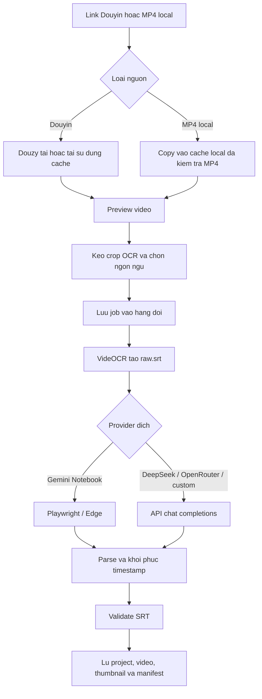

# VietSub Studio - Phần mềm tạo phụ đề tiếng Việt từ video Douyin và MP4

<p align="center">
  
</p>

<p align="center">
  <strong>OCR phụ đề cháy trên video · dịch tiếng Việt · bảo toàn timestamp SRT · xử lý hàng đợi trên Windows.</strong>
</p>

<p align="center">
  <a href="https://github.com/qvinh8726/VietSub-Studio/releases/latest">Tải bản portable mới nhất</a>
  · <a href="https://github.com/qvinh8726/VietSub-Studio/issues">Báo lỗi / đề xuất</a>
  · <a href="CONTRIBUTING.md">Đóng góp</a>
</p>

<p align="center">
  
  
  
  
  
</p>

VietSub Studio là ứng dụng desktop Windows mã nguồn mở giúp **tạo phụ đề tiếng Việt từ video Douyin hoặc file MP4 local**. Ứng dụng kết hợp preview vùng OCR, VideOCR, Douzy, Gemini Notebook qua Microsoft Edge, DeepSeek API, OpenRouter và API OpenAI-compatible để tạo ra file `.vi.srt` có timestamp an toàn.

Nếu bạn đang tìm **phần mềm OCR phụ đề video Trung Quốc**, **công cụ dịch phụ đề Douyin sang tiếng Việt**, **SRT translator trên Windows**, hoặc **cách giữ nguyên timestamp khi dịch phụ đề**, đây là workflow mà VietSub Studio cung cấp.

> [!IMPORTANT]
> Bản portable chỉ đóng gói VietSub Studio. Ứng dụng **không** kèm Douzy, VideOCR, FFmpeg, Microsoft Edge, tài khoản Google, Gemini Notebook hay tài khoản API. Hãy cài các phụ thuộc bên thứ ba từ nguồn bạn tin cậy và tuân thủ điều khoản của từng dịch vụ.

## Muc luc

- [VietSub Studio la gi?](#vietsub-studio-la-gi)
- [Doi tuong su dung](#doi-tuong-su-dung)
- [Tinh nang noi bat](#tinh-nang-noi-bat)
- [Quy trinh xu ly](#quy-trinh-xu-ly)
- [Dau vao va dau ra](#dau-vao-va-dau-ra)
- [Yeu cau he thong](#yeu-cau-he-thong)
- [Cai dat nhanh bang EXE portable](#cai-dat-nhanh-bang-exe-portable)
- [Thiet lap lan dau](#thiet-lap-lan-dau)
- [Cach xu ly mot video](#cach-xu-ly-mot-video)
- [Dich phu de Notebook va API](#dich-phu-de-notebook-va-api)
- [Prompt dich mac dinh va block code SRT](#prompt-dich-mac-dinh-va-block-code-srt)
- [Hang doi retry va khoi phuc](#hang-doi-retry-va-khoi-phuc)
- [Chay tu ma nguon](#chay-tu-ma-nguon)
- [CLI khong giao dien](#cli-khong-giao-dien)
- [Build EXE Windows](#build-exe-windows)
- [Du lieu local va cau hinh](#du-lieu-local-va-cau-hinh)
- [Bao mat va quyen rieng tu](#bao-mat-va-quyen-rieng-tu)
- [Gioi han va luu y phap ly](#gioi-han-va-luu-y-phap-ly)
- [Xu ly loi thuong gap](#xu-ly-loi-thuong-gap)
- [Kiem thu va dong gop](#kiem-thu-va-dong-gop)
- [Giay phep](#giay-phep)

## VietSub Studio la gi?

VietSub Studio khong phai la video editor va khong thay the Douzy, VideOCR hay nha cung cap AI. No la lop dieu phoi giup ban lap lai mot quy trinh phu de on dinh:

1. Nhap link video Douyin hoac chon file MP4 tren may.
2. Xem preview va keo khung OCR dung vao vung chu tren video.
3. Chon ngon ngu OCR, che do OCR va ten project.
4. Dua nhieu video vao hang doi, xu ly tuan tu de tranh tranh chap tai nguyen.
5. Chay VideOCR de tao phu de goc `.raw.srt`.
6. Dich bang Gemini Notebook qua Edge hoac bang API tuong thich OpenAI.
7. Kiem tra so block, index, timestamp va noi dung SRT truoc khi danh dau thanh cong.
8. Luu video, phu de, thumbnail va manifest vao mot thu muc project doc lap.

Ung dung chay Flask chi bind vao `.127.0.0.1`, hien thi bang cua so pywebview/WebView2. Neu WebView native khong khoi dong kip, app tu dong chuyen sang trinh duyet cuc bo.

## Doi tuong su dung

- Creator lam video ngan, video Douyin hoac noi dung Trung Quoc can phu de tieng Viet.
- Nhom dich thuat can OCR phu de da ghi san (burned-in subtitles) thanh SRT co the chinh sua.
- Nguoi dung muon dich SRT bang Gemini Notebook, DeepSeek, OpenRouter hoac gateway API rieng.
- Nha phat trien Windows muon co pipeline OCR -> translation -> validation co the retry va kiem tra bang unit test.

## Tinh nang noi bat

### Nhan video va quan ly nguon

- Nhan URL video Douyin day du, link ngan `.v.douyin.com` va ca doan share co chua URL.
- Tu dong trich URL, kiem tra hostname va tu choi domain gia mao.
- Tu choi link profile, playlist va mix vi moi job dai dien cho mot video cu the.
- Nhan file `.mp4` local; workflow local khong can Douzy.
- Tai lai video da co trong history/cache cua Douzy thay vi tai lai khong can thiet.
- Doc title, video path, metadata va cover tu Douzy neu co.
- Chi chuyen MP4 va asset lien quan vao project sau khi phu de dich da vuot validation.
- MP4 local duoc copy vao cache do app quan ly de hang doi co the song qua lan khoi dong; khi cung o cung dia, app uu tien hard-link vao project va fallback sang copy neu filesystem khong ho tro.

### Preview va OCR chinh xac

- Preview video truoc khi chay OCR.
- Khung crop truc quan co the keo va doi kich thuoc de chi quet vung phu de.
- Luu crop mac dinh va crop rieng cho tung job.
- Ho tro ngon ngu OCR: `.ch`, `.en`, `.ja`, `.ko`, `.vi`.
- Ho tro che do VideOCR: `.auto`, `.fast`, `.accurate`.
- Ho tro bo qua tu `.0` den `.10` frame.
- Dung FFprobe neu co de quy doi toa do preview ve dung do phan giai nguon.
- Video dai hon 45 phut duoc tach thanh cac doan OCR 10 phut, sau do merge lai theo timestamp goc.
- Neu VideOCR gap segment HEVC/mixed-resolution, app co the dung FFmpeg chuan hoa segment va thu lai.

### Dich phu de tieng Viet

- Gemini Notebook qua Microsoft Edge voi profile debug rieng.
- DeepSeek API voi preset mac dinh `.https://api.deepseek.com` / `.deepseek-v4-pro`.
- OpenRouter voi preset mac dinh `.https://openrouter.ai/api/v1` / `.deepseek/deepseek-chat`.
- API OpenAI-compatible tuy chinh: nhap Base URL, model va API key theo gateway cua ban.
- API request dung endpoint `./chat/completions`.
- API co streaming SSE khi gateway ho tro; gateway khong ho tro se tu dong fallback ve JSON day du.
- API tu dong retry toi da 3 lan cho loi tam thoi; phan hoi qua lon, JSON hong, output bi cat hoac SRT khong hop le se bi bao loi ro rang.
- Video khong qua 45 phut co the dich mot request; video dai hon duoc chia chunk bao toan timestamp, toi da 400 block hoac 24.000 ky tu moi chunk.

### Hang doi va khoi phuc

- Chuan bi nhieu job truoc khi bam chay.
- OCR va dich chay tuan tu, chi mot worker xu ly tai mot thoi diem.
- Prefetch toi da mot video Douyin ke tiep sau khi job hien tai roi khoi buoc download.
- Luu job `.queued`, `.running`, `.success`, `.error`, `.cancelled` vao file JSON atomic.
- Ho tro huy job dang chay, xoa job dang cho va don job da ket thuc.
- Job loi co the retry tu buoc hop ly nhat: chuan bi video, OCR hoac dich.
- Neu app dong khi job dang chay, lan mo sau job duoc danh dau can retry thay vi gia thanh cong gia.
- Giu log tien trinh va output trung gian de khong phai download/OCR lai neu chi loi o buoc dich.

### Kiem tra SRT va project

- Giu nguyen index va timestamp cua SRT goc.
- Neu model sua timestamp nhung van giu duoc block tuong ung, app co the khoi phuc timestamp goc.
- Tu choi output rong, thieu block, doi index, timestamp sai, SRT khong parse duoc hoac thieu file.
- Chi hien thi job thanh cong khi video reference, `.raw.srt` va `.vi.srt` deu ton tai.
- Xu ly ten project an toan cho Windows, tranh reserved name va them hau to `.(2)`, `.(3)` neu trung.
- Ghi `.project.json` voi source URL, video ID, status, error, output paths va update time.
- Ho tro thumbnail `.jpg`, `.jpeg`, `.png`, `.webp` khi Douzy cung cap cover hoac metadata hop le.

### Desktop, cap nhat va chan doan

- Giao dien responsive tren pywebview/WebView2.
- Bang health check cho Douzy sidecar, Douzy config/database, VideOCR, FFmpeg, FFprobe, provider dich va Edge.
- Xem history Douzy va chon lai video gan day.
- Chon thu muc output rieng, khong phu thuoc thu muc download cua Douzy.
- Canh bao khi output nam trong OneDrive vi dong bo cloud co the lam cham file video lon.
- Tao lai shortcut Desktop cho ban EXE portable.
- Kiem tra GitHub Releases, thong bao ban moi va ho tro tai/cai ban portable chinh thuc.
- Trinh cap nhat kiem tra repository, asset, checksum SHA-256, kich thuoc va EXE truoc khi thay the ban dang chay.

## Quy trinh xu ly



Nguyen tac quan trong: **SRT chi duoc coi la thanh cong sau khi validation cuoi cung pass**. Neu provider tra ve thieu block hoac chen giai thich vao SRT, job se dung va cho phep retry.

## Dau vao va dau ra

### Dau vao duoc ho tro

```
https://www.douyin.com/video/1234567890123456789
https://v.douyin.com/xxxxxx/
```

Ban co the dan ca doan share co chua mot trong hai URL tren. Link profile, playlist, mix va URL khong tro toi mot video don se bi tu choi.

File tu may phai la `.mp4`, khong rong, nho hon hoac bang `.8 GiB` va co header container `.ftyp` hop le.

### Cau truc project ket qua

Voi ten project `.Product Review`, app tao mot thu muc tu chua:

```
Product Review/
|-- Product Review.mp4
|-- Product Review.thumbnail.jpg   (neu co cover)
|-- Product Review.raw.srt          (phu de OCR ngon ngu goc)
|-- Product Review.vi.srt            (phu de dich tieng Viet)
|-- Product Review.data.json         (neu Douzy cung cap)
|-- Product Review.music.mp3         (neu Douzy cung cap)
+-- project.json                     (manifest)
```

`*.raw.srt` là đầu ra OCR để bạn kiểm tra. `*.vi.srt` là file phụ đề tiếng Việt đã qua kiểm tra cấu trúc. Timestamp và số thứ tự được giữ theo SRT gốc; app không render video hay ghi phụ đề trực tiếp vào video.

## Yeu cau he thong

| Thanh phan | Bat buoc khi | Cai dat / ghi chu |
|---|---|---|
| Windows 10/11 x64 | Moi workflow | Tich hop hien tai la Windows-first. |
| Python 3.12+ | Chay tu source | Python 3.11+ ve mat ly thuyet; CI va build duoc kiem tra voi Python 3.12. |
| VideOCR CLI | Moi workflow OCR | Mac dinh: `C:\\Program Files\\VideOCR\\videocr-cli.exe`. |
| Douzy | Nguon Douyin | Tai video va quan ly history/cache. Khong can neu chon MP4 local. |
| Microsoft Edge | Gemini Notebook; link ngan Douyin | Edge duoc chay voi profile debug tai cong local `.9222`. |
| Tai khoan Google | Provider Gemini Notebook | Dang nhap trong profile Edge cua app. |
| DeepSeek / OpenRouter / custom API | Provider API | Can Base URL, model va key theo provider. |
| FFmpeg + FFprobe | Khuyen nghi manh | Ho tro video dai, chunk OCR va mixed-resolution recovery. |

Douzy va VideOCR la phan mem ben thu ba, khong duoc phan phoi trong repository nay.

## Cai dat nhanh bang EXE portable

1. Mo [GitHub Releases](https://github.com/qvinh8726/VietSub-Studio/releases/latest).
2. Tai asset co ten `VietSub-Studio-Portable-v*.zip`.
3. Tai file checksum di kem neu muon kiem tra toan ven file.
4. Giai nen vao thu muc co quyen ghi; khong chay EXE truc tiep trong cua so xem ZIP.
5. Mo `VietSub Studio.exe`.
6. Lan chay dau co the cham hon do PyInstaller giai nen tai nguyen va Windows Defender quet file.
7. Neu SmartScreen canh bao, hay kiem tra dung URL release va checksum truoc khi chon **More info -> Run anyway**.
8. Mo **Thiet lap** va xu ly cac muc health check dang loi.

### Kiem tra checksum tren PowerShell

```powershell
$zip = \".\\VietSub-Studio-Portable-v1.5.3.zip\"
Get-FileHash $zip -Algorithm SHA256
Get-Content \".\\VietSub-Studio-Portable-v1.5.3.zip.sha256\"
```

Chi tiep tuc neu hash tinh duoc trung voi hash tren GitHub Release. Ban portable khong duoc ky so, vi vay SmartScreen co the van hien canh bao du da kiem tra checksum.

## Thiet lap lan dau

### 1. Douzy cho video Douyin

1. Cai Douzy va mo ung dung it nhat mot lan.
2. Chon thu muc tai video trong Douzy.
3. Tai thu mot video neu Douzy chua tao database.
4. Mo VietSub Studio va xem health check:
   - Douzy sidecar: `%LOCALAPPDATA%\\Programs\\Douzy\\resources\\sidecar\\win32-x64\\douyin-dl-sidecar.exe`
   - Douzy config: `%APPDATA%\\douyin-downloader-desktop\\config.yml`
   - Douzy database: `%APPDATA%\\douyin-downloader-desktop\\dy_downloader.db`

Douzy database co the chua co ngay sau khi cai; trang thai nay khong ngan MP4 local va thuong tu day sau lan tai dau tien.

### 2. VideOCR va FFmpeg

- Cai VideOCR sao cho file `C:\\Program Files\\VideOCR\\videocr-cli.exe` ton tai.
- Cai FFmpeg, them `ffmpeg` va `ffprobe` vao `PATH`.
- Neu phu de nam o mot goc co dinh, van nen dung crop trong VietSub Studio de giam noise OCR.
- Thu voi mot video ngan truoc khi dua video dai vao hang doi.

### 3. Chon cach dich

Trong **Thiet lap -> Cach dich phu de**, chon mot provider:

| Provider | Can gi | Khi nen dung |
|---|---|---|
| Gemini Notebook qua Edge | URL Notebook + Google session | Muon dung Notebook hien co, khong can API key trong app. |
| DeepSeek API | API key | Muon pipeline API tu dong, co streaming va retry. |
| OpenRouter | API key + model | Muon doi model/gateway trong mot API endpoint. |
| API OpenAI-compatible khac | Base URL + model; key tuy endpoint | Dung gateway local, 9router hoac nha cung cap tuong thich. |

URL Notebook phai co dang:

```
https://gemini.google.com/notebook/NOTEBOOK_ID
```

Khong dung URL chat Gemini thong thuong thay cho URL Notebook.

### 4. Thu muc output

De trong de app dung `Documents\\VietSub Studio` (hoac thu muc Windows fallback). Ban cung co the chon thu muc rieng trong Settings. Tranh dat output trong OneDrive neu ban thuong xu ly video nhieu GB; dong bo cloud co the lam cham move, hard-link, mo folder va cleanup.

## Cach xu ly mot video

1. Dan link Douyin vao o nguon hoac bam **Chon MP4**.
2. Bam **Tai preview** / **Chuan bi preview**.
3. Keo khung mau vao dung vung phu de; co the doi kich thuoc o bon goc.
4. Chon ngon ngu OCR: `ch`, `en`, `ja`, `ko` hoac `vi`.
5. Dat ten project neu muon; de trong se dung title Douyin hoac ten file MP4.
6. Bam **Them vao hang doi**.
7. Lap lai voi video khac neu can, sau do bam **Chay hang doi**.
8. Theo doi cac buoc: `resolve` -> `download` -> `ocr` -> `translate` -> `done`.
9. Neu Google yeu cau dang nhap, bam **Mo Edge dang nhap**, dang nhap xong roi bam **Chay lai** job.
10. Mo project tu card ket qua sau khi app bao thanh cong.

### Meo de OCR tot hon

- Crop sat vung subtitle nhung khong cat mat chu.
- Chon dung ngon ngu chu hien tren video; `ch` la lua chon mac dinh cho tieng Trung.
- Giam `frames to skip` neu chu nho, chay nhanh hoac thay doi lien tuc.
- Dung `fast` cho preview thu; dung `accurate` khi can chat luong cao va may du tai nguyen.
- Luon kiem tra `*.raw.srt` truoc khi danh gia chat luong ban dich.

## Dich phu de Notebook va API

### Gemini Notebook qua Edge

Che do Notebook dung Playwright ket noi toi Microsoft Edge co profile rieng, mac dinh cong debug `9222`. Edge khong chay headless; tuy chon **Chay Edge an** chi lam cua so khong tranh focus trong qua trinh binh thuong.

Khi session Google het han, app co the hien cua so Edge de ban dang nhap. VietSub Studio khong doc mat khau Google va khong dong goi cookie vao repo.

### DeepSeek API

Preset trong app:

```
Base URL: https://api.deepseek.com
Model:    deepseek-v4-pro
```

Hay bam **Kiem tra ket noi API** truoc khi chay hang doi. API key duoc ma hoa bang Windows DPAPI va chi giai ma duoc tren tai khoan Windows da luu key.

### OpenRouter

Preset trong app:

```
Base URL: https://openrouter.ai/api/v1
Model:    deepseek/deepseek-chat
```

Ban co the thay model bang model phu hop trong dashboard OpenRouter. Gia, han muc va chinh sach luu prompt phu thuoc OpenRouter/model ban chon.

### API OpenAI-compatible tuy chinh

Nhap endpoint HTTPS co dang base URL, model va key theo gateway. App se goi:

```
POST <base-url>/chat/completions
Content-Type: application/json
```

HTTP khong ma hoa chi duoc chap nhan cho `localhost`, `127.0.0.1` hoac `::1` de tranh gui key qua mang khong an toan.

## Prompt dich mac dinh va block code SRT

VietSub Studio co prompt dich mac dinh huong toi phu de Trung -> Viet, dac biet voi ngu canh game va khoa hoc vien tuong. Prompt mac dinh bao gom:

- Dich tu nhien, muot, bam ngu canh thay vi dich word-by-word.
- Chon dai tu nhan xung theo quan he va tinh cach nhan vat, giu nhat quan.
- Giu nguyen so thu tu va timestamp cua tung block.
- Khong bo sung loi giai thich vao noi dung SRT.
- Liet ke ngan gon thuat ngu, ten rieng va dai tu da dung **ben ngoai** block SRT de hau kiem.

Sau lop prompt tuy chinh, app luon them hop dong dau ra ky thuat:

```
DAU VAO LA TIENG TRUNG. DAU RA BAT BUOC LA TIENG VIET.
Khong chep lai cau tieng Trung va khong xuat song ngu.
Giu nguyen index va timestamp; chi dich noi dung subtitle.
Dat toan bo SRT da dich trong dung mot block code srt.
```

Vi vay provider duoc yeu cau tra SRT theo block code chuan:

````markdown
```srt
1
00:00:01,000 --> 00:00:03,000
Noi dung tieng Viet
```
````

Neu ban nhap **Cach dich mong muon** trong Settings, noi dung do se thay the glossary/prompt mac dinh; cac rang buoc ve ngon ngu, index, timestamp va mot block code `srt` van duoc app them vao sau. Gioi han truong nay la `16.000` ky tu.

## Hang doi, retry va khoi phuc

Hang doi toi da luu `500` job. Moi job co the o mot trong cac trang thai `queued`, `running`, `success`, `error` hoac `cancelled`.

- **Huy job dang chay:** dung tien trinh con dang hoat dong va giu cac job dang cho.
- **Retry tu OCR:** dung khi video van con va loi chi xay ra trong VideOCR.
- **Retry tu dich:** dung khi `*.raw.srt` con hop le nhung provider tra loi loi.
- **Retry tu video:** dung khi file nguon khong con hoac can tai lai.
- **Mo lai app:** job dang `running` duoc chuyen ve loi co the retry, khong bi danh dau thanh cong gia.

App ghi file queue va config theo kieu atomic. Neu file JSON bi hong, app quarantine file loi va tao cau hinh mac dinh de khoi dong an toan hon.

## Chay tu ma nguon

### Cai dat

```powershell
git clone https://github.com/qvinh8726/VietSub-Studio.git
cd VietSub-Studio
python -m venv .venv
.\\.venv\\Scripts\\Activate.ps1
python -m pip install --upgrade pip
python -m pip install -r requirements.txt
```

Neu PowerShell chan script activation, co the goi truc tiep Python trong venv:

```powershell
.\\.venv\\Scripts\\python.exe -m pip install -r requirements.txt
.\\.venv\\Scripts\\python.exe app.py
```

### Chay giao dien desktop

```powershell
python app.py
```

App uu tien cua so native pywebview/WebView2. Neu native WebView loi hoac timeout, app tu dong chuyen sang trinh duyet cuc bo.

### Chay server local o cong 5000

```powershell
python app.py --server
```

Sau do mo `http://127.0.0.1:5000`. Tuy chon nay phu hop de smoke test, debug frontend va kiem tra asset. Khong expose cong nay ra Internet.

### Chay browser mode voi cong ngau nhien

```powershell
python app.py --browser
```

Browser mode tu chon cong local trong may va tu mo trinh duyet mac dinh.

### Script Windows co san

- `Chay Tool.bat`: cai dependency runtime neu thieu roi chay app.
- `build_portable.bat`: cai dependency build va tao EXE portable.
- `build_app.bat`: tao ban onedir de debug/build thay the.

## CLI khong giao dien

`automate.py` thuc hien workflow Douyin OCR va dich tu tuyen lenh:

```powershell
python automate.py --url \"https://www.douyin.com/video/1234567890123456789\" --lang ch --name \"Review san pham\"
```

| Tham so | Bat buoc | Mo ta |
|---|---:|---|
| `-u`, `--url` | Co | Link video Douyin. |
| `-l`, `--lang` | Khong | `ch`, `en`, `ja`, `ko` hoac `vi`; mac dinh `ch`. |
| `-n`, `--name` | Khong | Ten chung cho project, video va subtitle. |

CLI van dung Douzy, VideOCR, Edge/Notebook va cau hinh local tuong tu desktop app. CLI khong nhan file MP4 local trong phien ban hien tai; dung giao dien desktop cho local MP4.

## Build EXE Windows

### Build portable mot file

```powershell
python -m pip install -r requirements-build.txt
python -m PyInstaller --noconfirm --clean --distpath dist_portable --workpath build_portable \"VietSub Studio Portable.spec\"
```

Ket qua nam tai:

```
dist_portable\\VietSub Studio.exe
```

Hoac chay:

```powershell
.\\build_portable.bat
```

### Build ban onedir

```powershell
python -m pip install -r requirements-build.txt
python -m PyInstaller --noconfirm --clean \"VietSub Studio.spec\"
```

Build onedir phu hop debug tai nguyen; build portable la asset phat hanh chinh. Khong commit `build_*`, `dist_*`, `release/` hoac file ZIP vao Git; CI tao artifact va GitHub Release luu asset phat hanh.

### Kiem tra truoc khi tao release

```powershell
python -m py_compile app.py automate.py
python -m unittest discover -s tests -v
python -m pip check
```

Workflow GitHub Actions cung chay unit test, compile, pip check, build PyInstaller va smoke-test EXE bang `--server`.

## Du lieu local va cau hinh

### Khi chay tu source

File runtime nam canh source:

```
app_config.json
workflow_queue.json
local_videos\\
vietsub-studio.log
instance.lock
```

### Khi chay EXE portable

File runtime nam trong:

```
%APPDATA%\\VietSub Studio\\app_config.json
%APPDATA%\\VietSub Studio\\workflow_queue.json
%APPDATA%\\VietSub Studio\\local_videos\\
%APPDATA%\\VietSub Studio\\vietsub-studio.log
%APPDATA%\\VietSub Studio\\instance.lock
```

Phu thuoc ben ngoai duoc tim tai:

```
%LOCALAPPDATA%\\Programs\\Douzy\\resources\\sidecar\\win32-x64\\douyin-dl-sidecar.exe
%APPDATA%\\douyin-downloader-desktop\\config.yml
%APPDATA%\\douyin-downloader-desktop\\dy_downloader.db
C:\\Program Files\\VideOCR\\videocr-cli.exe
%LOCALAPPDATA%\\Microsoft\\Edge\\User Data Debug\\
```

`app_config.example.json` la mau cau hinh an toan de tham khao. Khong commit `app_config.json`, API key, Notebook URL rieng, cookie, profile Edge hay video local.

## Bao mat va quyen rieng tu

- Flask chi bind `127.0.0.1`; app khong phat control API ra mang LAN/Internet.
- Moi lan khoi dong tao capability token moi cho cac request frontend.
- API kiem tra Host, Origin, Fetch Metadata, duong dan va JSON content type doi voi mutation.
- Upload local chi nhan `.mp4`, gioi han `8 GiB` va kiem tra header `ftyp` truoc khi luu cache.
- API key duoc ma hoa bang Windows DPAPI; key da luu chi giai ma duoc tren tai khoan Windows da luu.
- Google credential nam trong profile Edge; VietSub Studio khong doc mat khau Google.
- Chi subtitle text duoc gui toi provider ban chon. Video local khong duoc upload toi server VietSub Studio.
- Updater chi chap nhan repository chinh thuc, asset dung ten, checksum va kich thuoc hop le.
- Community EXE khong ky so; checksum giup phat hien file bi thay doi nhung khong thay the hoan toan chu ky so.

Xem [SECURITY.md](SECURITY.md) de bao cao loi bao mat. Khi mo issue, khong gui API key, cookie, link Notebook rieng, link video rieng hay log chua du lieu nhay cam.

## Gioi han va luu y phap ly

- Hien tai chi ho tro Windows 10/11 x64.
- Hang doi OCR/dich chay tuan tu, khong chay song song nhieu VideOCR hoac Gemini worker.
- Douzy chi can cho nguon Douyin; MP4 local khong can Douzy.
- VideOCR bat buoc cho OCR; chat luong phu de phu thuoc do phan giai, contrast, font, motion va crop.
- Edge can cho Gemini Notebook va cho mot so link Douyin ngan can redirect.
- FFmpeg/FFprobe khong bat buoc voi video ngan co do phan giai on dinh, nhung rat nen cai cho video dai.
- Giao dien Gemini co the thay doi, khi do selector automation co the can cap nhat.
- Dich AI co the sai ngu canh; luon kiem tra `*.raw.srt` va `*.vi.srt` truoc khi dang tai.
- Ban tu chiu trach nhiem ve quyen su dung, ban quyen va dieu khoan cua Douyin, Google, Douzy, VideOCR va provider AI.

## Xu ly loi thuong gap

### Health check bao \"Douzy sidecar: Thieu\"

Kiem tra file:

```
%LOCALAPPDATA%\\Programs\\Douzy\\resources\\sidecar\\win32-x64\\douyin-dl-sidecar.exe
```

Mo Douzy mot lan, chon thu muc tai, roi bam **Kiem tra lai** trong VietSub Studio.

### \"Cau hinh Douzy: Thieu\"

Kiem tra:

```
%APPDATA%\\douyin-downloader-desktop\\config.yml
```

Hay mo Douzy va luu cau hinh download truoc khi thu lai.

### \"VideOCR CLI: Thieu\"

Cai VideOCR vao duong dan mac dinh hoac tao file dung ten tai:

```
C:\\Program Files\\VideOCR\\videocr-cli.exe
```

### Gemini khong tim thay khung chat / yeu cau dang nhap

1. Bam **Mo Edge dang nhap**.
2. Dang nhap Google trong cua so Edge ma app mo.
3. Mo dung Notebook URL dang `https://gemini.google.com/notebook/<id>`.
4. Cho khung chat hien ra, roi bam **Chay lai** job.

### Edge debug port `9222` bi ban

Dong cac phien Edge debug cu roi mo lai VietSub Studio. Khong tat nham Edge ca nhan dang chay voi profile thong thuong.

### API tra ve SRT thieu block hoac output bi cat

- Bam **Kiem tra ket noi API**.
- Kiem tra Base URL co dung va provider co ho tro `/chat/completions`.
- Kiem tra model co du output token cho chunk hien tai.
- Giam kich thuoc video/chunk hoac dung provider co context/output lon hon.
- Retry tu buoc **Dich** neu file `*.raw.srt` van con.

### OCR sai nhieu

Thu crop hep hon, tang chat luong video, chon dung ngon ngu, giam frame skip va thu model `accurate`. Neu chu bi che, bong, watermark hoac chay ngang man hinh, hay chinh crop va xem lai `*.raw.srt` truoc khi dich.

### EXE mo cham hoac SmartScreen canh bao

Day la dac diem thuong thay cua PyInstaller one-file va EXE cong dong chua ky so. Chi chay file tu GitHub Release chinh thuc sau khi doi chieu checksum.

## Kiem thu va dong gop

Chay test local:

```powershell
python -m py_compile app.py automate.py
python -m unittest discover -s tests -v
python -m pip check
```

Truoc khi tao PR:

1. Khong commit file runtime ca nhan (`app_config.json`, queue, log, video).
2. Khong commit artifact PyInstaller (`build_*`, `dist_*`, `release/`).
3. Ghi ro thay doi, ly do va cach kiem thu.
4. Neu sua luong dich, them test cho parse SRT, timestamp, provider va retry.

Xem [CONTRIBUTING.md](CONTRIBUTING.md) de biet quy uoc dong gop.

## Giay phep

VietSub Studio phat hanh theo [MIT License](LICENSE). Douzy, VideOCR, Microsoft Edge, Google Gemini, DeepSeek, OpenRouter va cac model AI la san pham/dich vu ben thu ba, co dieu khoan va giay phep rieng.

---

### English summary

VietSub Studio is an open-source Windows desktop workflow for converting burned-in subtitles from Douyin videos or local MP4 files into validated Vietnamese SRT subtitles. It provides OCR-region preview, VideOCR integration, sequential queueing, Gemini Notebook through Edge, DeepSeek/OpenRouter/OpenAI-compatible APIs, timestamp-preserving translation, retryable intermediate files, and a verified portable EXE release.

Keywords: Vietnamese subtitle generator, Douyin subtitle OCR, Chinese-to-Vietnamese subtitle translation, SRT translator, VideOCR, Gemini Notebook, DeepSeek API, OpenRouter, Windows portable EXE.
