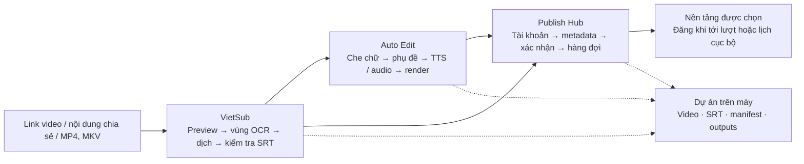

<p align="center">
  
</p>

<h1 align="center">VietSub Studio</h1>

<p align="center">
  <strong>Từ video gốc đến phụ đề Việt, bản dựng và hàng đợi xuất bản.</strong><br>
  <strong>3-in-1 Creator Workbench</strong> mã nguồn mở cho Windows với ba workspace: <strong>VietSub · Auto Edit · Publish Hub</strong>.
</p>

<p align="center">
  <a href="https://github.com/qvinh8726/VietSub-Studio/releases/latest"></a>
  <a href="https://github.com/qvinh8726/VietSub-Studio/actions/workflows/tests.yml"></a>
  <a href="LICENSE"></a>
  
  <a href=".github/workflows/tests.yml"></a>
  <a href="https://github.com/qvinh8726/VietSub-Studio/stargazers"></a>
</p>

<p align="center">
  <a href="https://github.com/qvinh8726/VietSub-Studio/releases/latest"><strong>Tải bản portable</strong></a> ·
  <a href="https://viet-sub-studio.vercel.app">Trang giới thiệu</a> ·
  <a href="https://github.com/qvinh8726/VietSub-Studio">Mã nguồn</a> ·
  <a href="https://github.com/qvinh8726/VietSub-Studio/issues">Báo lỗi / Đề xuất</a>
</p>

> **VietSub Studio v2.1.0 · 25/11/2026.** Cập nhật ký số Ed25519 fail-closed, Publish Hub v2 (Assisted Upload + YouTube Data API v3 + `selectors.json`), Glossary, Trình sửa SRT trực tiếp + phụ đề động ASS, Hồ sơ Kênh + Auto Pipeline, AI gợi ý Hook và giao diện **Neutral Studio Dark**. Xem [thay đổi v2.1.0](#v210), [changelog](<CHANGELOG.md>) và [trang phát hành](<https://github.com/qvinh8726/VietSub-Studio/releases/tag/v2.1.0>). Badge phía trên lấy trạng thái release/CI trực tiếp từ GitHub.

VietSub Studio kết nối các công cụ tải video, OCR, dịch, FFmpeg và trình duyệt thành một quy trình có preview, hàng đợi, lưu dự án và chạy lại theo giai đoạn. Bạn giữ video, phụ đề và kết quả dựng trên máy; dịch văn bản, TTS và đăng video sử dụng dịch vụ bên ngoài khi chọn các chức năng đó.

**Portable không đồng nghĩa đã có mọi phụ thuộc.** Bản EXE đóng gói ứng dụng, giao diện và yt-dlp. VideOCR, FFmpeg/FFprobe, trình duyệt, tài khoản dịch, runtime JavaScript cho YouTube và các runtime AI tùy chọn cần chuẩn bị theo [yêu cầu hệ thống](#requirements).

<a id="contents"></a>
## Mục lục

- [Ba workspace, một dự án](#workspaces)
- [Tính năng và giới hạn thực tế](#features)
- [Thay đổi trong v2.1.0](#v210)
- [Thay đổi trong v2.0.2 (TTS song song & cache)](#v202)
- [Yêu cầu hệ thống](#requirements)
- [Cài portable, kiểm tra SHA256 và cập nhật](#portable)
- [Thiết lập lần đầu](#setup)
- [Quy trình sử dụng](#workflow)
- [Kết quả và dữ liệu cục bộ](#data)
- [Phím tắt và thao tác bàn phím](#shortcuts)
- [Chạy từ mã nguồn, kiểm thử và build](#development)
- [Quyền riêng tư và bảo mật](#privacy)
- [Khắc phục sự cố và FAQ](#faq)
- [Đóng góp, giấy phép và ghi nhận](#credits)

<a id="workspaces"></a>
## Ba workspace, một dự án

Chuyển workspace ở thanh bên trái để tiếp tục cùng dự án. Đổi workspace không tải lại trang và không xóa preview, crop hay hàng đợi VietSub. Thao tác bàn giao chỉ chuẩn bị dữ liệu cho bước tiếp theo; bạn vẫn chủ động bấm render hoặc gửi hàng đợi đăng.



| Workspace | Công việc chính | Kết quả |
|---|---|---|
| **VietSub** | Nhập video, xem vùng chữ, OCR bằng VideOCR, dịch kèm Glossary qua Gemini Notebook/API, chọn Hồ sơ Kênh & Chạy 1 mạch | Video và phụ đề gốc/Việt, thumbnail khi có, metadata dự án |
| **Auto Edit** | Sửa SRT trực tiếp + Live Preview, che chữ cũ, phụ đề động ASS, AI gợi ý Hook/banner/logo, đổi khung hình, xử lý audio/TTS, render | MP4 mới, track giọng đọc hoặc audio tách riêng; gói CapCut Draft thử nghiệm |
| **Publish Hub** | Quản lý profile/YouTube Data API v3, chế độ Bán tự động (`Assisted Upload`), Debug Trace, chuẩn bị metadata, xếp hàng/lên lịch | Trạng thái riêng cho từng tài khoản và kết quả xác nhận từ nền tảng |

Hướng dẫn sâu hơn: [Auto Edit và TTS](<docs/AUTO_EDIT_GUIDE.md>), [Publish Hub và giới hạn từng nền tảng](<docs/PUBLISH_HUB_GUIDE.md>). Các hướng dẫn này có mốc phiên bản riêng; phần TTS v2.0.2 đang được đối chiếu sau tích hợp.

<a id="features"></a>
## Tính năng và giới hạn thực tế

### VietSub: từ chữ trong video đến SRT tiếng Việt

- Nhận **một video** từ Douyin, Kuaishou, Xiaohongshu, Bilibili, TikTok, YouTube; nhận cả đoạn chia sẻ có chứa URL. Playlist, profile, bộ sưu tập và livestream không được tự mở rộng thành hàng đợi.
- Chọn **MP4/MKV trên máy** bằng hộp thoại native. File được đọc tại chỗ; khi hoàn tất, app ưu tiên hard link cùng ổ đĩa hoặc sao chép nếu không hỗ trợ. Trong chế độ trình duyệt, chọn file là upload MP4 vào server cục bộ và cần thêm dung lượng tạm.
- Douyin thử trang chia sẻ qua HTTP, rồi trình duyệt riêng, sau đó yt-dlp; Kuaishou dùng trình duyệt. Các nguồn yt-dlp phụ thuộc extractor, phiên đăng nhập và chính sách nền tảng. Tải HTTP dùng tối đa sáu kết nối khi máy chủ hỗ trợ byte ranges; không bảo đảm một mức tăng tốc cố định.
- Preview có vùng OCR kéo/thay đổi kích thước. Hỗ trợ ngôn ngữ nguồn Trung, Anh, Nhật, Hàn, Việt; chọn model OCR và bỏ qua khung hình theo cấu hình VideOCR. Đầu ra dịch hiện hướng tới **tiếng Việt**.
- Một worker OCR/dịch xử lý tuần tự; có thể tải trước một video kế tiếp trong lúc job hiện tại OCR/dịch. Hàng đợi được lưu và chạy lại từ video/raw SRT còn hợp lệ.
- Dịch qua **Gemini Notebook**, **DeepSeek API**, **OpenRouter** hoặc API tương thích OpenAI. API lưu tiến độ theo đoạn; Gemini Notebook chưa có khả năng tiếp tục từ đoạn cuối tương đương API.
- Khôi phục số thứ tự/timecode từ bản gốc khi có đủ block tương ứng; từ chối SRT thiếu, dính block hoặc sai cấu trúc. Kiểm tra cấu trúc không thay thế việc đọc lại nội dung bản dịch.
- Kết quả chỉ được đánh dấu sẵn sàng khi video và phụ đề cần thiết tồn tại, hợp lệ. Tên dự án trùng có hậu tố, không ghi đè dự án trước.

Douzy không còn là phụ thuộc tải video. App vẫn có thể đọc thư viện Douzy cũ để dùng lại tài sản còn tồn tại.

### Auto Edit: dựng video và lồng tiếng

- Che vùng chữ bằng **boxblur**, **delogo** hoặc thanh màu; vùng editor độc lập với crop OCR. Delogo là phép xử lý FFmpeg, không phải AI inpainting.
- Ghép phụ đề ASS với font cục bộ, cỡ/màu/viền/bóng/nền; thêm banner và logo PNG. Preview nguồn không hiển thị đầy đủ hiệu ứng trước render, nên cần xem lại MP4 kết quả.
- Giữ khung nguồn hoặc chuyển sang 9:16; có cấu hình tốc độ video, preview audio ngắn và các preset. Thay đổi timeline cần được kiểm tra trên video xuất.
- Giữ âm thanh gốc, mute, tách MP3/WAV; tách instrumental cần runtime/model riêng. Tách giọng không bảo đảm giữ mọi tiếng động hoặc loại hết lời nói.
- **CapCut TTS** là lựa chọn mặc định; **Edge TTS** là provider tùy chọn. Nghe thử gửi câu mẫu; tạo track từ SRT gửi nội dung phụ đề. Căn từng câu theo timestamp, bù khoảng lặng, giới hạn tăng tempo/trim và có cảnh báo khi câu quá dài.
- Có tùy chọn ducking để hạ nhạc/âm thanh nền lúc giọng đọc xuất hiện. Khi fallback CapCut → Edge được bật, giọng có thể thay đổi và app phải báo rõ provider thực dùng.
- Render bằng FFmpeg, có tiến độ/hủy; thử encode NVENC thật và fallback CPU khi cần. Output được ghi riêng và kiểm tra lại trước khi bàn giao.
- **CapCut Draft ZIP đang thử nghiệm.** Media có thể đã chứa hiệu ứng/phụ đề/audio được render; không phải mọi thành phần đều trở thành track chỉnh sửa độc lập. Cần thử import trên đúng phiên bản CapCut desktop, relink media khi cần; kiểm tra JSON/ZIP không chứng minh import thực tế đã thành công.

CapCut dùng giao thức nội bộ, Edge dùng dịch vụ online không chính thức. Catalog giọng không chứng minh quyền sử dụng mọi giọng, độ ổn định giao thức hoặc dịch vụ đang hoạt động. Core portable không chứa model ONNX, Demucs, torch hay runtime tách giọng.

### Publish Hub: chuẩn bị và đăng nhiều tài khoản

Mỗi tài khoản có profile trình duyệt độc lập; đăng nhập, QR, CAPTCHA và xác minh do người dùng thực hiện. Hub nhận MP4 đã edit hoặc MP4 được chọn chủ động, lưu title/description/hashtags và có nút tạo đề xuất AI từ SRT để bạn duyệt.

| Nền tảng | Public | Private | Draft rõ ràng | Điều kiện/giới hạn |
|---|---|---|---|---|
| TikTok | Có | Có | Có | Kiểm tra lại privacy trong form |
| YouTube Video/Shorts | Có | Có | Chưa hỗ trợ explicit | Cấu hình audience/kênh trong Studio; nền tảng quyết định video có được phân loại Shorts |
| Facebook Page / Meta Business Suite | Có | Không | Có | Cần Page/asset ID phù hợp; không hỗ trợ profile cá nhân tùy ý |
| Douyin | Có | Có | Có | Có thể yêu cầu xác minh thủ công |
| Bilibili | Có | Không | Có | Category, copyright và tags cần được chuẩn bị đúng |
| Xiaohongshu | Có | Có | Chưa hỗ trợ explicit | Không coi autosave ngầm là draft thành công |

Đây là capability của adapter, **không phải bảo đảm đăng thành công trên mọi tài khoản/region**. Khi form hoặc quyền không nhận diện được, job dừng để xác minh. Tests mock không chứng minh nền tảng đã chấp nhận video thật.

Lịch đăng là **lịch cục bộ theo Asia/Saigon (UTC+07)**: app, máy và mạng phải đang hoạt động; đây không phải lịch native chạy trên server nền tảng. Public cần xác nhận. Nếu submit xong nhưng kết quả chưa rõ (`uncertain`), hãy kiểm tra tài khoản trước khi retry để tránh đăng trùng. Hủy job không thu hồi nội dung đã được nền tảng nhận.

<a id="v210"></a>
## Thay đổi trong v2.1.0

Bản **v2.1.0** nâng cấp đồng bộ toàn diện trên cả bốn trụ cột: bảo mật cập nhật, độ bền Publish Hub, quy trình biên tập–tự động hóa và giao diện desktop.

| Trụ cột | Điểm mới chính |
|---|---|
| **Bảo mật & Cập nhật 1-click** | Xác thực chữ ký số **Ed25519 fail-closed** (khóa công khai nhúng sẵn `47fad5684b02ccba`, bắt buộc `.zip.sig` bên cạnh `.zip` và `.zip.sha256.txt`); bảo vệ `TESTING=False` (CSRF token, Host/Origin, strict JSON); mã hóa DPAPI cho bí mật/OAuth2; bộ lọc log/lỗi tập trung `vietsub/redaction.py` |
| **Publish Hub v2** | Chế độ **Bán tự động (`Assisted Upload`)** mặc định an toàn; **Debug Mode + Playwright Trace** ký HMAC; tách `selectors.json` hỗ trợ ghi đè nóng `selectors.override.json`; nút **Dọn đã xong** (`DELETE /api/uploader/queue/finished`); tùy chọn **YouTube Data API v3** (OAuth2 PKCE + Resumable Upload không phình EXE) |
| **Biên tập & Tự động hóa** | **Từ điển thuật ngữ (Glossary)** lưu theo hồ sơ; **Trình sửa SRT trực tiếp** đồng bộ 2 chiều với Video Player + Live Preview + hoàn tác `.bak` + cảnh báo `srt_stale_assets`; **Phụ đề động ASS** (`karaoke_highlight`, `word_pop`); **Hồ sơ Kênh (Channel Presets)** + **Chạy 1 mạch (Auto Pipeline)**; **AI gợi ý Hook** cho Top Banner |
| **Giao diện Neutral Studio Dark** | Tông xám than trung tính (`#111214 → #262a32`) với một màu nhấn Studio Blue (`#4c8bf5`); mở thoáng layout `1280×720` trên cả 3 Workspace (Hàng đợi VietSub, Split-view Video + SRT, Hàng đợi Publish Hub); Ngăn Thiết lập 3 tab gọn nhẹ và tinh giản hiệu ứng Sakuga VFX |

<a id="v202"></a>
## Thay đổi trong v2.0.2

Bản v2.0.2 tập trung vào tốc độ và độ ổn định của TTS, cao độ riêng giọng đọc và khả năng tái sử dụng audio trong dự án.

| Hạng mục | Hành vi của đợt sửa |
|---|---|
| Form TTS | Nút **Tạo TTS từ phụ đề** lấy lựa chọn hiện tại của form, gồm provider, voice, fallback, tốc độ/cao độ, kể cả khi chưa bấm lưu |
| Kết nối và polling | Tái sử dụng HTTP qua `requests.Session`/connection pool. Mỗi câu CapCut có **deadline tổng tối đa 20 giây cho create → poll → tải audio**, connect tối đa 8 giây/read 15 giây trong thời gian còn lại; tối đa một retry. Poll tăng dần 0,15 → 0,25 → 0,4 → 0,8 giây và kiểm tra hủy trong khi chờ |
| Chạy nhiều câu có giới hạn | Mặc định **3 worker CapCut / 5 worker Edge**; giảm tải khi gặp HTTP 429. Đây là song song các câu TTS, không phải nhiều job OCR hoặc render cùng lúc |
| Cache và batch | Cache audio thô theo provider/voice/text trong `raw-v1` dưới cache project; đổi speed/pitch cục bộ có thể tái dùng audio. Chuẩn hóa/ghép bằng FFmpeg theo batch và giữ thứ tự timestamp |
| Pitch riêng TTS | UI mới chỉ đổi cao độ giọng đọc, giữ tông nhạc/âm thanh gốc; tốc độ vẫn đổi timeline. Manifest/payload cũ thiếu trường `tts_change_pitch` giữ hành vi legacy để tương thích; lưu/chạy từ UI mới chuyển sang phạm vi TTS |
| Tiến độ và thông báo | Hiện số câu đã tạo/tổng số câu, trạng thái HTTP/poll và lý do fallback; thông tin thành công thông thường không còn hiện như cảnh báo lỗi |

[Config mẫu](<app_config.example.json>) có `editor_tts_capcut_workers` (1–6, mặc định 3), `editor_tts_edge_workers` (1–8, mặc định 5) và `editor_tts_batch_size` (1–30, mặc định 25). Giá trị phải là số nguyên trong giới hạn. Giữ mặc định trước khi cân chỉnh theo máy/provider; adapter tùy chỉnh chưa bảo đảm chạy đồng thời vẫn dùng luồng tuần tự.

Benchmark offline trên Windows 11 / Python 3.14.3: **85 câu, timeline 3 phút 58 giây**, độ trễ provider giả lập 150 ms/câu và xử lý FFmpeg thật, batch 25 câu. Không gọi dịch vụ CapCut/Edge trong phép đo.

| Chế độ | Thời gian | So với tuần tự | Lượt gọi provider | Tiến trình audio |
|---|---:|---:|---:|---:|
| Pipeline tuần tự làm mốc | 24,59 s | 1× | 85 | 255 |
| Pipeline CapCut, 3 worker | 5,74 s | **4,28×** | 85 | 8 |
| Pipeline Edge, 5 worker | 4,03 s | **6,10×** | 85 | 8 |
| Đổi pitch với raw cache đã có, 3 worker | 1,22 s | 20,09× | **0** | 8 |

Có thể tái lập bằng [script benchmark](<tools/benchmark_tts.py>): `python tools/benchmark_tts.py --cues 85 --latency .15 --output artifacts/tts-benchmark-v2.0.2.json`. Đây là số đo pipeline với provider mô phỏng, **không phải cam kết tốc độ dịch vụ live**. Thời gian thực tế phụ thuộc provider, mạng, độ dài câu, CPU/FFmpeg và cache nóng/lạnh.

<a id="requirements"></a>
## Yêu cầu hệ thống

| Thành phần | Khi nào cần | Ghi chú |
|---|---|---|
| **Windows 10/11 x64** | Ứng dụng desktop/portable | Các tích hợp hiện tại tập trung Windows; không công bố hỗ trợ macOS/Linux |
| **WebView2 Runtime** | Cửa sổ desktop native | Cài [runtime chính thức của Microsoft](<https://developer.microsoft.com/microsoft-edge/webview2/>) nếu máy thiếu; chế độ browser có thể dùng để chẩn đoán |
| **VideOCR CLI** | OCR chữ trong video | Mặc định app tìm `C:\Program Files\VideOCR\videocr-cli.exe`; cài và cấu hình theo hướng dẫn của VideOCR |
| **FFmpeg và FFprobe trong PATH** | Auto Edit, TTS alignment, extract/render; nên có cho OCR video dài | FFmpeg cần filter/encoder liên quan như ASS/libass và libx264. Không đóng gói trong portable hiện tại |
| **Chrome / Edge / Chromium phù hợp** | Notebook, nguồn tải cần browser, Publish Hub | Cài trình duyệt và chọn đường dẫn trong Thiết lập khi cần; dùng profile riêng của app |
| **Gemini Notebook + Google login** hoặc **API dịch** | Dịch SRT và tạo metadata AI | Notebook URL dạng `https://gemini.google.com/notebook/<id>`; API cần Base URL/model/key hợp lệ |
| **yt-dlp** | Các nguồn dùng extractor | Có trong portable; cài qua [requirements](<requirements.txt>) khi chạy source |
| **Deno 2.3+ hoặc Node.js 22+** | Tải YouTube | Có `deno` hoặc `node` trong PATH để xử lý JavaScript challenge |
| **Python ngoài + edge-tts** | Provider Edge TTS | Tùy chọn, không cần nếu không dùng Edge; portable EXE không thay cho Python interpreter |
| **audio-separator + runtime/model phù hợp** | Tách instrumental | Tùy chọn; model không được tải ngầm hoặc bundle cùng core |
| **Python x64; khuyến nghị 3.12** | Chạy/build từ source | CI Windows dùng Python 3.12; người dùng EXE không cần cài Python cho core |
| **Node.js 24** | Chạy bộ test frontend / phát triển landing theo CI | Không phải yêu cầu để mở EXE core |

GPU NVIDIA không bắt buộc: renderer có CPU fallback. Chưa có benchmark để đưa ra cấu hình RAM/VRAM tối thiểu được bảo đảm. Hãy chừa dung lượng cho video nguồn, bản render, cache TTS, file tạm và bản sao MP4 độc lập của **một lượt upload**. SSD và thư mục xuất ngoài vùng đồng bộ cloud thường giúp giảm tranh chấp I/O.

<a id="portable"></a>
## Cài portable, kiểm tra SHA256 và cập nhật

1. Mở [GitHub Releases chính thức](<https://github.com/qvinh8726/VietSub-Studio/releases/latest>), đọc ghi chú của phiên bản thực tế được phát hành.
2. Tải `VietSub-Studio-Portable-v<version>.zip`, file checksum `.zip.sha256.txt` và (từ v2.1.0+) file chữ ký Ed25519 `.zip.sig`.
3. Kiểm tra SHA256 của ZIP (và có thể xác minh chữ ký Ed25519 bằng `python tools/sign_release.py verify --zip .\VietSub-Studio-Portable-v<version>.zip`), so với giá trị trong file checksum. Trong ví dụ PowerShell dưới đây, thay `<version>` bằng phiên bản bạn tải.
4. Giải nén vào thư mục có quyền ghi, rồi chạy `VietSub Studio\VietSub Studio.exe`. Không chạy từ bên trong cửa sổ xem ZIP.
5. Mở **Thiết lập** (3 tab: Chung · Dịch & Từ điển · Hồ sơ kênh) và kiểm tra các phụ thuộc theo workspace định dùng. Lần đầu EXE one-file có thể cần thời gian giải nén và được Windows quét.

```powershell
Get-FileHash -Algorithm SHA256 -LiteralPath ".\VietSub-Studio-Portable-v<version>.zip"
Get-FileHash -Algorithm SHA256 -LiteralPath ".\VietSub Studio\VietSub Studio.exe"
```

ZIP theo hợp đồng updater có cấu trúc:

```text
VietSub Studio/
├── VietSub Studio.exe
├── SHA256.txt
├── LICENSE
└── HUONG_DAN_SU_DUNG.txt
```

Checksum bên cạnh ZIP xác minh **ZIP**; `SHA256.txt` bên trong xác minh **EXE**. Bản cộng đồng hiện không có chữ ký Authenticode. Nếu SmartScreen cảnh báo, kiểm tra nguồn và checksum trước khi quyết định mở; không cần tắt phần mềm bảo vệ máy.

App kiểm tra release GitHub và có banner cập nhật. Từ **v2.1.0**, trình cập nhật xác thực theo cơ chế **fail-closed**: kiểm tra URL repo chính thức, checksum SHA256 của ZIP, digest/kích thước GitHub, **chữ ký số Ed25519 (`.zip.sig`) khớp khóa công khai nhúng sẵn (`47fad5684b02ccba`)** và `SHA256.txt` của EXE bên trong trước khi thay thế/khởi động lại (bản `v2.0.x` lên `v2.1.0` dùng SHA256 cũ, sau đó toàn bộ bản nâng cấp kế tiếp bắt buộc có chữ ký Ed25519 hợp lệ). Nếu không thể cài tại chỗ, dùng trang release để cập nhật thủ công.

Cấu hình bản EXE nằm trong `%APPDATA%\VietSub Studio`, nên có thể di chuyển thư mục portable. Sao lưu dữ liệu cần thiết và đóng tác vụ đang chạy trước khi thay bản. Không chép đè thư mục config hoặc project chỉ để cập nhật EXE.

<a id="setup"></a>
## Thiết lập lần đầu

### 1. Chọn nơi lưu và chuẩn bị công cụ

Trong **Thiết lập**, chọn thư mục xuất. Nếu để trống, mặc định là `Documents\VietSub Studio` theo thư mục Windows của tài khoản. Kiểm tra VideOCR, FFmpeg/FFprobe và trình duyệt trong bảng tình trạng. Với video dài hoặc dự án lớn, ưu tiên nơi còn đủ dung lượng và tránh OneDrive nếu không muốn đồng bộ media liên tục.

### 2. Chọn cách dịch

- **Gemini Notebook:** tạo/mở notebook được phép truy cập, dán URL đúng dạng `https://gemini.google.com/notebook/<id>`. Dùng nút mở trình duyệt của app để đăng nhập Google trong profile đó.
- **API:** chọn DeepSeek, OpenRouter hoặc API tương thích OpenAI; nhập Base URL, model, key và bấm kiểm tra kết nối. Key được lưu riêng theo provider/host, không dùng lẫn khi đổi dịch vụ.
- Prompt mặc định trung tính. Có thể dùng preset **Game Delta Force** khi phù hợp hoặc tự viết quy tắc dịch. OCR tiếng Việt dùng để hiệu đính; đầu ra vẫn theo quy ước phụ đề Việt.

### 3. Đăng nhập nguồn video khi cần

Trong **Nguồn tải video & đăng nhập**, mở nền tảng bằng trình duyệt app và đăng nhập thủ công. CAPTCHA hiện trong cửa sổ để bạn xử lý. Trạng thái session có thể là chưa biết; có cookie không luôn đồng nghĩa đã đăng nhập. Có thể cấu hình Cookie header hoặc Netscape cookies theo hướng dẫn UI, nhưng không chia sẻ các giá trị này trong issue/log.

Trình duyệt tự động hóa dùng profile riêng, có thể chạy headless và chuyển sang cửa sổ hiển thị khi cần xác minh. App không lấy profile Chrome cá nhân của bạn để tự động đăng nhập.

### 4. Runtime Auto Edit tùy chọn

Vào **Runtime Auto Edit**, chọn đường dẫn tuyệt đối đến Python ngoài nếu dùng Edge hoặc tách giọng. Cài package vào **đúng interpreter** được chọn, ví dụ:

```powershell
& "C:\Python312\python.exe" -m pip install edge-tts
& "C:\Python312\python.exe" -m pip install "audio-separator[cpu]"
```

Lệnh thứ hai chỉ cần khi dùng tách instrumental; còn cần model và metadata tương thích theo giấy phép riêng. Nút sao chép lệnh trong UI không tự cài package. Thiếu các runtime này không ngăn blur, ghép phụ đề, mute hoặc extract bằng FFmpeg.

<a id="workflow"></a>
## Quy trình sử dụng

### Bước 1 — Làm phụ đề trong VietSub

1. Dán link/đoạn chia sẻ hoặc chọn MP4/MKV trên máy.
2. Nạp preview, đặt tên dự án nếu muốn và chỉnh khung OCR vào vùng phụ đề.
3. Chọn ngôn ngữ nguồn, thêm vào hàng đợi; lặp lại cho các video khác.
4. Bấm **Chạy hàng đợi**. Theo dõi tải video → OCR → dịch → kiểm tra kết quả.
5. Nếu lỗi, đọc thông báo và dùng retry sau khi khắc phục; app tận dụng video/raw SRT còn hợp lệ. **Hủy job** dừng item hiện tại, không tự xóa mọi item chờ.
6. Mở dự án, đọc lại phụ đề Việt và sửa lỗi OCR/dịch trước khi dựng hoặc đăng.

Không bật tự xóa video nguồn nếu còn cần Auto Edit hoặc Publish Hub. Dọn hàng loạt mặc định ưu tiên giữ phụ đề; luôn xem inventory/xác nhận trước thao tác xóa file.

### Bước 2 — Dựng trong Auto Edit

1. Từ kết quả hoặc job hoàn tất, chọn **Chuyển sang Auto Edit**.
2. Kiểm tra crop nguồn, chọn cách che chữ, style phụ đề, banner/logo và khung hình.
3. Chọn audio gốc/mute/instrumental; nếu cần lồng tiếng, chọn provider và giọng, nghe thử trước.
4. Tạo track TTS từ SRT hoặc bật TTS khi render. Nghe lại các câu bị cảnh báo dài/trim/fallback.
5. Render và theo dõi tiến độ. Kiểm tra hình, tiếng, timecode trong MP4 xuất, rồi chuyển video đã edit sang Publish Hub.

### Bước 3 — Chuẩn bị xuất bản

1. Tạo profile cho từng tài khoản, đăng nhập thủ công và kiểm tra session.
2. Chọn video, sửa metadata; nếu tạo bằng AI, duyệt đề xuất trước khi lưu.
3. Chọn tài khoản, visibility được hỗ trợ và đăng khi tới lượt hoặc lịch cục bộ.
4. Kiểm tra nội dung/tài khoản, xác nhận public nếu cần, rồi gửi hàng đợi.
5. Theo dõi từng job. Với `needs_verification` hoặc `uncertain`, xác minh trên nền tảng trước khi tiếp tục/retry.

<a id="data"></a>
## Kết quả và dữ liệu cục bộ

Ví dụ dự án đã hoàn tất VietSub:

```text
Ten du an/
├── Ten du an.mp4                  # hoặc MKV, tùy nguồn
├── Ten du an.raw.srt              # OCR gốc
├── Ten du an.vi.srt               # bản dịch Việt
├── Ten du an.thumbnail.jpg        # khi có ảnh bìa
├── Ten du an.data.json            # metadata nguồn khi có
├── project.json                  # manifest tương thích luồng VietSub
└── Ten du an.project.json         # sidecar trao đổi giữa các workspace
```

Auto Edit bổ sung các output với tên riêng; manifest lưu đường dẫn render/TTS/extract và trạng thái từng workspace. Tên chính xác phụ thuộc tác vụ, không nên hardcode đường dẫn output trong script riêng.

| Dữ liệu | Chạy từ source | Bản EXE |
|---|---|---|
| Cấu hình, hàng đợi, log, khóa instance | Thư mục source mặc định | `%APPDATA%\VietSub Studio` |
| Profile tải video/Notebook | Thư mục config: `chrome_debug_profile`, `edge_debug_profile` hoặc `custom_browser_profile` | Cùng quy tắc trong thư mục config EXE |
| Profile/queue Publish Hub | `uploader` dưới thư mục config | Cùng quy tắc |
| MP4 upload ở chế độ browser | `local_videos` dưới thư mục config | Cùng quy tắc |
| Video đang chờ hoàn tất dự án | `.vietsub-downloads` dưới thư mục xuất | Cùng quy tắc |
| Preview/cache editor | Cache theo config hoặc project tùy tác vụ | Không phải file dùng chung công khai |
| Dự án và output | Thư mục xuất đã chọn | Cùng quy tắc |

`VIETSUB_STUDIO_CONFIG_DIR` đổi thư mục config; `VIETSUB_STUDIO_DOWNLOAD_DIR` đổi nơi tải. Các biến này hữu ích để cách ly môi trường thử nghiệm. Tham khảo [config mẫu không chứa bí mật](<app_config.example.json>), không dùng cấu hình thật làm fixture test.

Video tải về được chuyển vào dự án sau khi kết quả VietSub hợp lệ. File local có thể là hard link: chỉnh trực tiếp nội dung một hard link cũng thay đổi dữ liệu nhìn từ đường dẫn kia. Hãy tạo bản sao độc lập nếu muốn sửa video nguồn bằng công cụ ngoài.

Cache giọng đọc vẫn chứa nội dung có thể nghe được, dù metadata không ghi phụ đề nguyên văn. Sao lưu dự án/config theo nhu cầu, và giữ profile/cookie/cache riêng tư. App có dọn downloads cũ theo quy tắc của nó; không coi thư mục cache tạm là nơi lưu trữ lâu dài duy nhất.

<a id="shortcuts"></a>
## Phím tắt và thao tác bàn phím

Các phím sau có tác dụng **khi focus ở control tương ứng**, không phải phím tắt toàn hệ thống.

| Vị trí đang focus | Phím | Tác dụng |
|---|---|---|
| Thanh chọn workspace | `↑` / `↓`, `Home` / `End` | Chuyển workspace trước/sau hoặc đầu/cuối |
| Tab nguồn, console, inspector | `←` / `→`, `Home` / `End` | Chuyển tab trong nhóm |
| Video preview VietSub | `Space` | Phát/tạm dừng |
| Video preview VietSub | `←` / `→` | Lùi/tiến theo bước khung hình |
| Khung crop Auto Edit | Các phím mũi tên | Di chuyển crop |
| Khung crop Auto Edit | `Shift` + mũi tên | Đổi kích thước crop |
| Khung crop Auto Edit | Giữ thêm `Alt` | Bước tinh hơn khi di chuyển/đổi cỡ |
| Thanh chia panel | Mũi tên theo trục, `Home` / `End`; giữ `Shift` | Chỉnh bố cục bằng bàn phím; Shift tăng bước |
| Drawer Thiết lập đang mở | `Esc`, `Tab` / `Shift+Tab` | Đóng drawer hoặc chuyển focus giữa control |

Hiệu ứng Sakuga có thể tắt trong Thiết lập và tôn trọng lựa chọn giảm chuyển động của hệ thống. Font được phục vụ cục bộ cùng ứng dụng.

<a id="development"></a>
## Chạy từ mã nguồn, kiểm thử và build

### Khởi động môi trường phát triển

```powershell
git clone https://github.com/qvinh8726/VietSub-Studio.git
cd VietSub-Studio
python -m venv .venv
.\.venv\Scripts\Activate.ps1
python -m pip install --upgrade pip
python -m pip install -r requirements.txt
python -m pip check
python app.py
```

[requirements](<requirements.txt>) ghim các dependency core; [requirements build](<requirements-build.txt>) bổ sung PyInstaller. [Chay Tool.bat](<Chay Tool.bat>) là launcher tiện dụng khác khi đã có Python phù hợp.

```powershell
# Tự chọn cổng loopback và mở trình duyệt mặc định
python app.py --browser

# Chỉ mở server cục bộ tại http://127.0.0.1:5000
python app.py --server

# CLI một video, dùng cấu hình đã lưu
python automate.py --url "https://www.douyin.com/video/<id>" --lang ch --name "Ten du an"
```

CLI hỗ trợ `--lang ch|en|ja|ko|vi` và tên dự án tùy chọn. Không chạy CLI và EXE đồng thời để điều khiển cùng VideOCR/profile. Đóng tab ở chế độ server/browser chưa chắc đã dừng tiến trình Python; dùng terminal quản lý tiến trình đã mở.

### Kiểm thử trước khi gửi thay đổi

Từ root repository, dùng Node 24 như CI. Câu lệnh Node dưới đây cố ý bao gồm cả tests mới ở root thư mục tests:

```powershell
python -m py_compile app.py automate.py tools/make_release.py
python -m compileall -q vietsub
python -m unittest discover -s tests -v
node --check static/app.js
node --check static/workbench.js
node --check static/editor.js
node --check static/uploader.js
node --check static/sakuga-vfx.js
node --test tests/frontend/*.test.mjs tests/*.js
```

Để chạy QA giao diện tổng hợp, cần FFmpeg/FFprobe và browser Playwright:

```powershell
python -m playwright install chromium
python tools/workbench_qa.py --output artifacts/workbench-qa
python tools/phase1_qa.py --output artifacts/phase1-qa
python tools/phase2_qa.py --output artifacts/phase2-qa
python tools/phase3_qa.py --output artifacts/phase3-qa
python tools/system_qa.py --output artifacts/system-qa
```

Các kiểm thử này dùng fixture/mocks ở ranh giới dịch vụ phù hợp; không chứng minh tài khoản thật đã đăng video. Một số test phụ thuộc quyền symlink, runtime có sẵn hoặc opt-in live có thể skip. Báo rõ pass/fail/skip và phạm vi môi trường của lần chạy; không lấy số test lịch sử làm kết quả hiện tại.

[Workflow CI](<.github/workflows/tests.yml>) gồm Python/Node, QA desktop, landing lint/typecheck/build và portable smoke. Badge CI liên kết workflow thực; khi review thay đổi phải xem run của đúng commit. Các lệnh test trong [CONTRIBUTING](<CONTRIBUTING.md>), [RELEASING](<RELEASING.md>) và CI bao gồm cả test frontend lẫn test Node ở root tests.

### Build portable tại máy

```powershell
python -m pip install -r requirements-build.txt
.\build_portable.bat
```

[build_portable](<build_portable.bat>) dùng [spec one-file](<VietSub Studio Portable.spec>), tạo EXE, đóng gói bằng [make_release](<tools/make_release.py>) và kiểm tra hợp đồng updater. Tên output lấy phiên bản trong source tại lúc build, không lấy từ tiêu đề README:

```text
dist_portable/VietSub Studio.exe
release/VietSub-Studio-Portable-v<version>.zip
release/VietSub-Studio-Portable-v<version>.zip.sha256.txt
```

[build_app](<build_app.bat>) và [spec onedir](<VietSub Studio.spec>) là lựa chọn đóng gói khác. Đọc [hướng dẫn phát hành](<RELEASING.md>) trước khi publish; tạo file ZIP tại máy không tự tạo GitHub Release.

### Bản đồ source

| Khu vực | Trách nhiệm |
|---|---|
| [app.py](<app.py>), [automate.py](<automate.py>) | Flask/desktop, điều phối VietSub và CLI |
| [vietsub/sources](<vietsub/sources/>) | Nguồn video, browser lifecycle, cookies, downloads |
| [vietsub/editor](<vietsub/editor/>) | Options, FFmpeg/render, audio, TTS và runtime tùy chọn |
| [vietsub/uploader](<vietsub/uploader/>) | Profile tài khoản, adapter nền tảng và queue đăng |
| [manifest](<vietsub/manifest.py>), [storage](<vietsub/storage.py>) | Dữ liệu dự án, inventory và cleanup |
| [templates](<templates/>), [static](<static/>) | UI vanilla JS/CSS, fonts và VFX cục bộ |
| [tests](<tests/>), [tools](<tools/>) | Regression, QA và đóng gói |
| [landing-page](<landing-page/>) | Trang giới thiệu Next.js riêng, không phải runtime desktop |

Audit dọn tài liệu nằm ở [bằng chứng cleanup v2.0.2](<docs/v2.0.2-cleanup-audit.md>): ghi rõ file nào giữ/xóa và lý do, không xóa config, dữ liệu cá nhân hoặc scratch lạ để làm sạch repository.

<a id="privacy"></a>
## Quyền riêng tư và bảo mật

- Flask chạy trên loopback `127.0.0.1`; API điều khiển có token mỗi phiên và kiểm tra Host/Origin. Đây là ứng dụng cục bộ, không phải dịch vụ web để mở public.
- OCR và FFmpeg xử lý trên máy. Chức năng **dịch** gửi văn bản SRT đến provider bạn chọn; **TTS** gửi nội dung cần đọc đến provider; **AI metadata** gửi nội dung khi bạn bấm tạo. **Publish Hub** upload video đến nền tảng sau khi bạn gửi hàng đợi/xếp lịch.
- App kết nối GitHub để kiểm tra cập nhật và tải release khi bạn chọn cài; nguồn video/browser/yt-dlp liên hệ nền tảng/CDN tương ứng. Không có yêu cầu gửi toàn bộ dự án lên máy chủ riêng của VietSub Studio.
- API key, Cookie header thủ công và OAuth2 token YouTube dùng Windows DPAPI; log đĩa và thông báo lỗi đi qua bộ lọc `vietsub/redaction.py` để ẩn bí mật và đường dẫn tài khoản. Profile trình duyệt và storage state vẫn là dữ liệu nhạy cảm trên máy. Publish Hub dùng profile riêng theo tài khoản, tách khỏi profile tải video/Notebook.
- Đừng đưa config thật, cookie, key, private Notebook URL, screenshot tài khoản hoặc cache giọng đọc vào issue công khai. Che thông tin cá nhân trong log trước khi chia sẻ.
- Chỉ tải/dịch/đăng nội dung và dùng tài khoản mà bạn có quyền; giấy phép mã nguồn không cấp quyền sử dụng nội dung, giọng hay model của bên thứ ba.

Xem [chính sách bảo mật](<SECURITY.md>) khi báo vấn đề nhạy cảm.

<a id="faq"></a>
## Khắc phục sự cố và FAQ

### EXE có chạy hoàn toàn offline không?

Core có thể xử lý file local bằng các công cụ đã cài; dịch online, TTS online, tải video, kiểm tra cập nhật và Publish Hub cần mạng tương ứng. VideOCR/FFmpeg/runtime tùy chọn không được tự cài chỉ vì đã giải nén EXE.

### Thiếu VideOCR hoặc FFmpeg thì làm gì?

Kiểm tra đường dẫn VideOCR mặc định và mở thử CLI theo tài liệu của nó. Với FFmpeg, chạy `ffmpeg -version` và `ffprobe -version` trong terminal, rồi mở lại app sau khi sửa PATH. Auto Edit và TTS alignment cần cả hai. GPU không có NVENC vẫn có thể dùng libx264 CPU.

### YouTube báo thiếu JavaScript runtime?

Cài Deno 2.3+ hoặc Node.js 22+, bảo đảm có trong PATH rồi mở lại app. Cập nhật yt-dlp khi extractor thay đổi; bản source dùng phiên bản được ghim trong [requirements](<requirements.txt>).

### Douyin/Kuaishou/Xiaohongshu yêu cầu đăng nhập hoặc CAPTCHA?

Mở nền tảng từ Thiết lập, đăng nhập/xác minh trong profile app rồi thử lại. Không phải mọi link đều là video công khai; bài chỉ có ảnh, link hết hạn hoặc quyền vùng/tài khoản có thể không tải được. App không tự giải CAPTCHA; thay đổi giao diện nền tảng có thể cần bản sửa mới.

### Gemini Notebook không bắt đầu dịch?

Kiểm tra URL notebook đúng định dạng, đăng nhập Google trong trình duyệt app và mở notebook đó thành công. Nếu trình duyệt đang bị giữ bởi phiên debug khác, xử lý tiến trình được nêu trong thông báo; không đóng hàng loạt Chrome cá nhân. API dịch là lựa chọn khác nếu đã có provider/key phù hợp.

### TTS chờ lâu, đổi giọng hoặc không tạo được audio?

Thử một câu ngắn bằng **Nghe thử**, kiểm tra provider/voice/fallback và runtime Edge nếu dùng. Xem trạng thái HTTP/poll/lỗi, hủy tác vụ rồi kiểm tra lại khi cần. Fallback có thể đổi giọng; tắt fallback nếu bạn muốn lỗi rõ thay vì dùng provider khác. Chỉ thấy catalog giọng không chứng minh dịch vụ đang nhận request. Không tăng concurrency tùy ý khi gặp rate limit.

### Có thể làm TTS nhanh hơn bằng cách đổi pitch không?

Pitch là hiệu ứng âm thanh, không làm dịch vụ tạo giọng nhanh hơn. v2.0.2 tách cache audio thô để thay đổi speed/pitch có thể tái dùng audio đã có; xem [benchmark và điều kiện đo](#v202). Hãy nghe lại câu bị tăng tempo/trim và kiểm tra việc giữ tiếng nền trên bản render cuối.

### OCR sai hoặc bản dịch bị từ chối?

Thu hẹp vùng OCR, chọn đúng ngôn ngữ/model và xem raw SRT trước. Chữ nhỏ, động, nền phức tạp và watermark đều làm giảm chất lượng. Lỗi số block/timecode được báo để tránh xuất SRT lệch; kiểm tra log và retry từ bước còn dùng lại được. OCR chia đoạn chưa bảo đảm tiếp tục từ đoạn cuối khi bị lỗi.

### Có thể hẹn giờ rồi tắt máy không?

Không. Lịch Publish Hub là local. Giữ app/máy/mạng hoạt động; kiểm tra queue sau khi mở lại. Với job đã submit nhưng chưa rõ kết quả, kiểm tra trang tài khoản trước khi retry. Không coi hủy là đã xóa video trên nền tảng.

### Có dùng được Facebook cá nhân hoặc mọi chế độ draft không?

Facebook hiện nhắm Page/Meta Business Suite. Draft/private phụ thuộc ma trận capability phía trên; không tự chuyển một chế độ không hỗ trợ sang public. YouTube audience và Bilibili category/copyright cần được chuẩn bị rõ ràng.

### Mở EXE không thấy cửa sổ, hoặc giao diện báo mất kết nối?

Giải nén hoàn chỉnh và chờ bước khởi động one-file, kiểm tra Windows Security và WebView2. Có thể chạy `--browser`/`--server` từ terminal để chẩn đoán. Banner mất kết nối phản ánh server local không trả lời; kiểm tra log và tiến trình trước khi mở thêm instance. Nếu gửi issue, kèm phiên bản thực, kiểu chạy, các bước tái hiện và log đã loại dữ liệu riêng tư.

<a id="credits"></a>
## Đóng góp, giấy phép và ghi nhận

Mã nguồn VietSub Studio dùng [MIT License](<LICENSE>). Đọc [CONTRIBUTING](<CONTRIBUTING.md>) trước khi gửi pull request, [CHANGELOG](<CHANGELOG.md>) để xem lịch sử và [SECURITY](<SECURITY.md>) cho báo cáo bảo mật. Dependency, model, nền tảng và tài sản bên thứ ba giữ giấy phép/điều khoản của họ.

| Thành phần | Ghi nhận |
|---|---|
| Hiệu ứng giao diện **Sakuga VFX** | [finktheartist/sakuga-vfx](<https://github.com/finktheartist/sakuga-vfx>), Justin Finkelman; [bản MIT kèm ứng dụng](<static/sakuga-LICENSE.txt>) |
| CapCut TTS protocol reference | [K07VN/capcut-tts-api](<https://github.com/K07VN/capcut-tts-api/tree/7ab87fbd12cbafa60bea4a48903eddf42a939b07>); [thông báo và giới hạn](<static/editor-THIRD-PARTY.txt>). Không phải API CapCut chính thức |
| Publish Hub reference | [dreammis/social-auto-upload](<https://github.com/dreammis/social-auto-upload/tree/3847fff01f5434a8a32829833163cd6723cabc59>); [thông báo third-party](<static/uploader-THIRD-PARTY.txt>) |
| Font cục bộ | Be Vietnam Pro, Noto Sans SC, JetBrains Mono; [OFL Be Vietnam Pro](<static/fonts/be-vietnam-pro-OFL.txt>), [OFL Noto Sans SC](<static/fonts/noto-sans-sc-OFL.txt>), [OFL JetBrains Mono](<static/fonts/jetbrains-mono-OFL.txt>) |
| Công cụ và thư viện nền tảng | [Flask](<https://flask.palletsprojects.com/>), [pywebview](<https://pywebview.flowrl.com/>), [Playwright](<https://playwright.dev/python/>), [yt-dlp](<https://github.com/yt-dlp/yt-dlp>), [Requests](<https://requests.readthedocs.io/>), [FFmpeg](<https://ffmpeg.org/>), VideOCR và các runtime tùy chọn |

Nếu dự án hữu ích, bạn có thể [đánh dấu sao repository](<https://github.com/qvinh8726/VietSub-Studio>), gửi lỗi có bước tái hiện hoặc đóng góp bản sửa có kiểm thử phù hợp.
